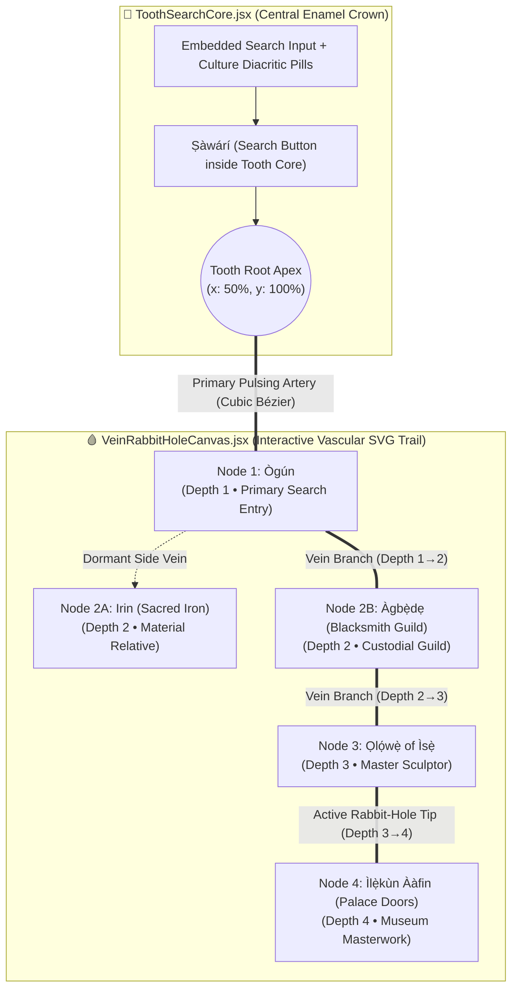
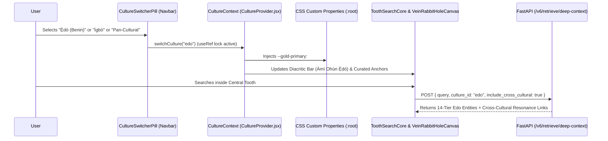

# 🔨 ENGINEERING BLUEPRINT (`AGY__BLUEPRINT_AGBEDE_001`)
**Author**: `Àgbẹ̀dẹ` (`agbede-builder` — Sovereign Blacksmith Guild & Master Sculptor `Ọlọ́wẹ̀ of Ìsẹ̀`)  
**Handoff Card**: `HANDOFF-AGBEDE-001`  
**Date**: 2026-10-20  
**Target Architecture**: Àgbà Engine v6.2.0 / v7.0-alpha  
**Hard Constraints Enforced**: Strict `<500-LOC` per file ceiling, flat early-return guard clauses, synchronous `useRef` UI double-tap locks, and 100% diacritic/orthographic parity across all peer cultures.

---

## Executive Summary & Current Baseline Audit

Before designing the three architectural pillars, `Àgbẹ̀dẹ` inspected the live codebase and identified two critical **500-LOC Ceiling Violations** that this blueprint directly resolves:
1. [`web/src/components/SearchTab.jsx`](file:///home/aruna_olanrewaju/agba-engine/web/src/components/SearchTab.jsx) is currently **1,279 lines** (monolithic search form, local ranking fallback, Bento grid, acoustic modal, and relative resolver all in one file).
2. [`api/app/retrieval.py`](file:///home/aruna_olanrewaju/agba-engine/api/app/retrieval.py) is currently **607 lines** and [`web/src/index.css`](file:///home/aruna_olanrewaju/agba-engine/web/src/index.css) is **483 lines** (17 lines away from the hard 500-line ceiling).

This blueprint decomposes `SearchTab.jsx` and `retrieval.py` into focused, single-responsibility modules strictly `<350 lines` each while delivering all three flagship pillars.

---

## PILLAR 1: The "Tooth & Vein" Rabbit-Hole Navigation UI (`/web/src/components/`)

### 1.1 Architectural Vision
Currently in `SearchTab.jsx` (lines 332–630), the Wisdom Tooth SVG sits above the search input and renders a static 4-pod dropdown only while the input is focused. The Lead Architect's vision transforms this into a **Living Vascular Rabbit-Hole Graph**:
- **The Central Tooth Search Anchor (`ToothSearchCore.jsx`)**: A sculpted anatomical molar/wisdom-tooth emblem positioned at the center-top of the exploration canvas, with the interactive search input, diacritic bar (`Àmì Ohùn`), and trigger button **embedded directly inside the enamel crown of the tooth**.
- **The Living Vein-Thread Graph (`VeinRabbitHoleCanvas.jsx` + `useExplorationGraph.js`)**:
  - When a user executes a search and opens **Entry 1** (`Node 1`), an animated, pulsing **vascular vein thread** (cubic Bézier SVG path with glowing amber/gold gradient and directional blood-flow dash animation) grows outward from the root apex of the Central Tooth directly into the header anchor of `Node 1`.
  - When the user clicks a **Connected Cultural Relative**, **Living Variant**, or **Sovereign Parent** inside `Node 1` (`Entry 2` / `Node 2`), the vein network **branches organically** (`Tooth [Root 0] ──► Node 1 ──► Node 2 ──► Node 3 ──► ...`), preserving every historical hop as an interactive vascular node on the canvas.
  - **Zero-Lost-Context Retracing**: No matter how deep into the rabbit hole a user travels (Depth 1 to Depth $N$), the entire vein trail remains visible and interactive (with auto-panning/zoom-to-fit and a sticky mini-map rail). Clicking **any upstream node along the vein** (or clicking the **Central Tooth** itself) smoothly retraces the viewport back to that exact ancestor state without losing the downstream branch (unless the user chooses to prune or fork a new branch).

### 1.2 Strict `<500-LOC` Component Decomposition Plan

To replace the 1,279-line `SearchTab.jsx` and prevent `index.css` (483 lines) from breaching 500 lines, we split the UI into 6 modular files:

| File Path | Target LOC | Single Responsibility |
| :--- | :--- | :--- |
| `web/src/hooks/useExplorationGraph.js` | `~185 LOC` | Directed Acyclic Graph (DAG) state machine for the Rabbit-Hole trail (`nodes`, `edges`, `activeNodeId`, `forkBranch`, `retraceToNode`, `resetToTooth`), `sessionStorage` persistence, and synchronous `useRef` transition locks. |
| `web/src/components/search/ToothSearchCore.jsx` | `~240 LOC` | Sculpted SVG Wisdom Tooth Crown with the search `<input>`, culture-aware diacritic pill bar, and `Ṣàwárí` submit button embedded directly inside the tooth chamber (`useRef` double-submit lock). |
| `web/src/components/search/VeinRabbitHoleCanvas.jsx` | `~290 LOC` | Responsive SVG + HTML overlay viewport that computes cubic Bézier control points between the Central Tooth root apex and every opened `Node 1 ... Node N`, rendering pulsing vascular threads and clickable ancestor waypoint pills. |
| `web/src/components/search/EntityBentoDeck.jsx` | `~310 LOC` | The 12-column Cellular Bento Grid for the currently focused node (Sovereign Identity, Acoustic Call & Dùndún Gángan Response, Museum Regalia, 14-Tier Accordion, and clickable Cultural Relatives that trigger `onBranchNode`). |
| `web/src/components/search/SearchTab.jsx` | `~220 LOC` | Clean orchestrator connecting `ToothSearchCore`, `VeinRabbitHoleCanvas`, `EntityBentoDeck`, and the FastAPI/local hybrid retrieval client. |
| `web/src/styles/tooth-vein.css` | `~190 LOC` | Dedicated stylesheet for the Tooth & Vein animations (`@keyframes veinPulse`, `@keyframes bloodFlowDash`, vascular node pills, and zoom/pan container), keeping `index.css` under 360 LOC. |

### 1.3 Graph State Machine (`web/src/hooks/useExplorationGraph.js`)

```javascript
// web/src/hooks/useExplorationGraph.js (~185 LOC)
import { useState, useRef, useCallback, useEffect } from 'react';

const STORAGE_KEY = 'agba_vein_rabbit_hole_v1';

export function useExplorationGraph(activeCulture = 'yoruba') {
  // Synchronous lock to prevent double-click race conditions during vein growth
  const navLockRef = useRef(false);

  const [graph, setGraph] = useState(() => {
    try {
      const saved = sessionStorage.getItem(STORAGE_KEY);
      if (saved) return JSON.parse(saved);
    } catch (_) { /* ignore storage errors */ }
    return {
      rootQuery: '',
      cultureId: activeCulture,
      nodes: [], // [{ nodeId, entityId, title, category, depth, parentNodeId, xOffset, timestamp, data }]
      edges: [], // [{ edgeId, fromId: 'TOOTH_ROOT' | nodeId, toId: nodeId, relationType }]
      activeNodeId: null
    };
  });

  useEffect(() => {
    try {
      sessionStorage.setItem(STORAGE_KEY, JSON.stringify(graph));
    } catch (_) { /* ignore quota errors */ }
  }, [graph]);

  // 1. Seed the first vein from the Central Tooth to Node 1
  const startVeinFromTooth = useCallback((queryText, firstEntity, fullResults) => {
    if (navLockRef.current || !firstEntity) return;
    navLockRef.current = true;

    const firstNodeId = `node_0_${firstEntity.id || firstEntity.entity_id}`;
    const firstNode = {
      nodeId: firstNodeId,
      entityId: firstEntity.id || firstEntity.entity_id,
      title: firstEntity.title,
      category: firstEntity.category || 'Sovereign Concept',
      depth: 1,
      parentNodeId: 'TOOTH_ROOT',
      branchIndex: 0,
      queryContext: queryText,
      entityData: firstEntity,
      searchPool: fullResults
    };

    setGraph({
      rootQuery: queryText,
      cultureId: activeCulture,
      nodes: [firstNode],
      edges: [{
        edgeId: `edge_TOOTH_ROOT_to_${firstNodeId}`,
        fromId: 'TOOTH_ROOT',
        toId: firstNodeId,
        relationType: 'PRIMARY_SEARCH_VEIN'
      }],
      activeNodeId: firstNodeId
    });

    setTimeout(() => { navLockRef.current = false; }, 180);
  }, [activeCulture]);

  // 2. Grow/branch a new vein when clicking deeper into the rabbit hole
  const branchVeinToRelative = useCallback((targetEntity, relationType = 'CULTURAL_RELATIVE') => {
    if (navLockRef.current || !targetEntity) return;
    navLockRef.current = true;

    setGraph((prev) => {
      const sourceId = prev.activeNodeId || 'TOOTH_ROOT';
      const sourceNode = prev.nodes.find((n) => n.nodeId === sourceId);
      const nextDepth = sourceNode ? sourceNode.depth + 1 : 1;
      const targetEntityId = targetEntity.id || targetEntity.entity_id || targetEntity.title;

      // If this entity already exists along the vein, retrace & highlight it instead of duplicating
      const existingNode = prev.nodes.find((n) => n.entityId === targetEntityId);
      if (existingNode) {
        return { ...prev, activeNodeId: existingNode.nodeId };
      }

      const siblingsAtDepth = prev.nodes.filter((n) => n.depth === nextDepth).length;
      const newNodeId = `node_${nextDepth}_${siblingsAtDepth}_${targetEntityId}`;

      const newNode = {
        nodeId: newNodeId,
        entityId: targetEntityId,
        title: targetEntity.title,
        category: targetEntity.category || 'Connected Relative',
        depth: nextDepth,
        parentNodeId: sourceId,
        branchIndex: siblingsAtDepth,
        queryContext: targetEntity.title,
        entityData: targetEntity
      };

      const newEdge = {
        edgeId: `edge_${sourceId}_to_${newNodeId}`,
        fromId: sourceId,
        toId: newNodeId,
        relationType
      };

      return {
        ...prev,
        nodes: [...prev.nodes, newNode],
        edges: [...prev.edges, newEdge],
        activeNodeId: newNodeId
      };
    });

    setTimeout(() => { navLockRef.current = false; }, 180);
  }, []);

  // 3. Click any ancestor node along the vein to retrace steps without losing the downstream trail
  const retraceToNode = useCallback((targetNodeId) => {
    if (navLockRef.current) return;
    if (targetNodeId === 'TOOTH_ROOT') {
      setGraph((prev) => ({ ...prev, activeNodeId: prev.nodes[0]?.nodeId || null }));
      window.scrollTo({ top: 0, behavior: 'smooth' });
      return;
    }
    setGraph((prev) => ({ ...prev, activeNodeId: targetNodeId }));
  }, []);

  // 4. Compute exact ancestor lineage path from TOOTH_ROOT -> activeNodeId for glowing primary vein
  const activeLineageIds = (() => {
    const path = new Set(['TOOTH_ROOT']);
    let curr = graph.nodes.find((n) => n.nodeId === graph.activeNodeId);
    while (curr) {
      path.add(curr.nodeId);
      curr = graph.nodes.find((n) => n.nodeId === curr.parentNodeId);
    }
    return path;
  })();

  return {
    graph,
    activeNode: graph.nodes.find((n) => n.nodeId === graph.activeNodeId) || null,
    activeLineageIds,
    startVeinFromTooth,
    branchVeinToRelative,
    retraceToNode,
    resetRabbitHole: () => setGraph({ rootQuery: '', cultureId: activeCulture, nodes: [], edges: [], activeNodeId: null })
  };
}
```

### 1.4 Central Tooth Search Anchor (`ToothSearchCore.jsx`) & Living Vein Canvas (`VeinRabbitHoleCanvas.jsx`)



#### Key Structural Specification of `ToothSearchCore.jsx`:
- **Anatomical SVG + HTML Hybrid**: Rather than placing a small 44px tooth icon *above* a rectangular input bar, `ToothSearchCore.jsx` renders a sculpted **bi-rooted molar silhouette container** (`max-width: 780px`) with an enamel crown arch at the top, lateral cusp contours on the sides, a pulp chamber in the center housing the `<input>`, the culture-specific diacritic bar (`Àmì Ohùn`), and the `Ṣàwárí` trigger button, tapering down into two anatomical root canals that converge at `#tooth-vascular-apex`.
- **Root Apex Coordinate Hook**: Exposes a `ref` (`toothApexRef`) at the exact bottom center of the tooth root (`x: 50%, y: 100%`) so `VeinRabbitHoleCanvas.jsx` can attach the origin point `(x0, y0)` of the primary SVG cubic Bézier curve directly to the bottom of the tooth.

#### Key Structural Specification of `VeinRabbitHoleCanvas.jsx`:
- **Dynamic Cubic Bézier Path Generator**:
  For every edge `e = (fromNode, toNode)` in `graph.edges`:
  $$P_{\text{bezier}}(t) = \text{M } x_1, y_1 \text{ C } x_1, \left(y_1 + \frac{\Delta y}{2}\right), \; x_2, \left(y_2 - \frac{\Delta y}{2}\right), \; x_2, y_2$$
- **Two-Layer SVG Stroke Rendering**:
  1. **Outer Vascular Wall**: `stroke: rgba(217, 119, 6, 0.28)`, `strokeWidth: 6px`, `filter: blur(2px)`.
  2. **Inner Arterial Pulse (Active Lineage)**: `stroke: url(#arterialGoldGrad)`, `strokeWidth: 2.8px`, `strokeDasharray: "10 6"`, animated via `@keyframes bloodFlowDash` so the user literally sees energy flowing from the Central Tooth down to their current rabbit-hole depth.
- **Interactive Ancestor Waypoint Nodes**:
  - Every visited entry (`Node 1` through `Node N`) is rendered as a compact, glowing **Vascular Node Pill** along the vein tree above the active Bento Deck.
  - Clicking **any** ancestor node (`Node 1`, `Node 2`, or the `🦷 Root Search` badge) invokes `retraceToNode(nodeId)`, immediately focusing that entry and lighting up its exact arterial path back to the Tooth.

---

## PILLAR 2: Equal Multi-Culture Ingestion & Seamless Culture-Swapping Architecture

### 2.1 First-Principle Mandate: Zero Epistemological Hierarchy
To expand Àgbà Engine beyond Yorùbá to **Edo (Benin Kingdom)**, **Igbo**, **Akan (Ashanti)**, **Nubia (Kush/Meroë)**, and **Dogon**, **no culture may be treated as a "plugin" or secondary translation layer**. Every culture is a **Peer Sovereign Civilization** governed by the exact same 14-Tier canonical depth, Sovereign Parent architecture, native orthographic restorer, and tri-modal museum/acoustic provenance.

### 2.2 The Universal Peer Culture Manifest (`api/data/cultures_registry.json`)

Every culture onboarded into Àgbà Engine registers a peer manifest in `cultures_registry.json`:

```json
{
  "schema_version": "7.0.0",
  "peer_equality_standard": "14_TIER_SOVEREIGN_PARITY",
  "cultures": {
    "yoruba": {
      "culture_id": "yoruba",
      "endonym": "Yorùbá",
      "exonym": "Yoruba",
      "sovereign_title": "ÀGBÀ ENGINE • ÌMỌ̀ YORÙBÁ",
      "orthography": {
        "alphabet_size": 25,
        "unicode_normalization": "NFC",
        "diacritic_label": "Àmì Ohùn",
        "diacritic_pills": ["À", "Á", "È", "É", "Ẹ̀", "Ẹ́", "Ì", "Í", "Ò", "Ó", "Ọ̀", "Ọ́", "Ù", "Ú", "Ṣ"],
        "tonal_registers": ["Low (À / Dò ↘)", "Mid (A / Rè →)", "High (Á / Mí ↗)"]
      },
      "acoustic_tradition": {
        "call_label": "Spoken Tonemic Call",
        "response_instrument": "Dùndún Gángan (Talking Drum)",
        "mimicry_mode": "Three-Tone Glissando Solfège"
      },
      "theme_tokens": {
        "primary_accent": "#d4af37",
        "secondary_accent": "#c85a32",
        "surface_tint": "rgba(212, 175, 55, 0.14)",
        "crest_motif": "royal_crown_tooth"
      },
      "corpus_file": "yoruba_corpus_1007_NORMALIZED.json",
      "sacred_canon_file": "agba_odu_ifa_256_canonical.json",
      "visual_manifest_file": "agba_unified_visual_regalia_manifest.json",
      "qdrant_collection": "agba_sovereign_knowledge"
    },
    "edo": {
      "culture_id": "edo",
      "endonym": "Ẹ̀dó (Bini)",
      "exonym": "Edo / Kingdom of Benin",
      "sovereign_title": "ÀGBÀ ENGINE • ÌMỌ̀ Ẹ̀DÓ",
      "orthography": {
        "alphabet_size": 24,
        "unicode_normalization": "NFC",
        "diacritic_label": "Àmì Ohùn Ẹ̀dó",
        "diacritic_pills": ["À", "Á", "È", "É", "Ẹ", "Ẹ̀", "Ẹ́", "Ì", "Í", "Ò", "Ó", "Ọ", "Ọ̀", "Ọ́", "Ù", "Ú", "Vb", "Kh", "Gh", "Rh", "Mw"],
        "tonal_registers": ["Low (À ↘)", "High (Á ↗)", "Downstep (!Á)"]
      },
      "acoustic_tradition": {
        "call_label": "Royal Court Proclamation (Ọba n'Ẹ̀dó)",
        "response_instrument": "Èmẹ́dọ́ & Ivory Horn (Àkọ̀hẹn)",
        "mimicry_mode": "Palace Guild Ceremonial Cadence"
      },
      "theme_tokens": {
        "primary_accent": "#e05a2b",
        "secondary_accent": "#d4af37",
        "surface_tint": "rgba(224, 90, 43, 0.15)",
        "crest_motif": "coral_bronze_tooth"
      },
      "corpus_file": "edo_corpus_NORMALIZED.json",
      "sacred_canon_file": "edo_ihuan_and_ogiso_canon.json",
      "visual_manifest_file": "edo_visual_bronzes_regalia_manifest.json",
      "qdrant_collection": "agba_sovereign_knowledge"
    },
    "igbo": {
      "culture_id": "igbo",
      "endonym": "Ásụ̀sụ̀ Ìgbò",
      "exonym": "Igbo",
      "sovereign_title": "ÀGBÀ ENGINE • ÀMÀMÌHÈ ÌGBÒ",
      "orthography": {
        "alphabet_size": 36,
        "unicode_normalization": "NFC",
        "diacritic_label": "Akara Udaolu (Ọnwụ)",
        "diacritic_pills": ["Ị", "Ị̀", "Ị́", "Ọ", "Ọ̀", "Ọ́", "Ụ", "Ụ̀", "Ụ́", "Ṅ", "À", "Á", "È", "É", "Ò", "Ó", "Ù", "Ú", "Gb", "Gh", "Gw", "Kp", "Kw", "Nw", "Ny", "Sh"],
        "tonal_registers": ["Low (À ↘)", "Step (Ā →)", "High (Á ↗)"]
      },
      "acoustic_tradition": {
        "call_label": "Spoken Ìgbò Prosody",
        "response_instrument": "Ikoro (Slit Drum) & Ọjà (Notched Flute)",
        "mimicry_mode": "Ọjà Speech-Surrogate Melodic Contour"
      },
      "theme_tokens": {
        "primary_accent": "#10b981",
        "secondary_accent": "#d4af37",
        "surface_tint": "rgba(16, 185, 129, 0.14)",
        "crest_motif": "nsibidi_ukara_tooth"
      },
      "corpus_file": "igbo_corpus_NORMALIZED.json",
      "sacred_canon_file": "igbo_afa_and_nsibidi_canon.json",
      "visual_manifest_file": "igbo_visual_igbo_ukwu_manifest.json",
      "qdrant_collection": "agba_sovereign_knowledge"
    },
    "akan": {
      "culture_id": "akan",
      "endonym": "Akan (Twi / Asante)",
      "exonym": "Akan / Ashanti",
      "sovereign_title": "ÀGBÀ ENGINE • NYANSA AKAN",
      "orthography": {
        "alphabet_size": 22,
        "unicode_normalization": "NFC",
        "diacritic_label": "Akan Orthography",
        "diacritic_pills": ["Ɛ", "ɛ", "Ɔ", "ɔ", "À", "Á", "È", "É", "Ì", "Í", "Ò", "Ó", "Ù", "Ú", "Dw", "Gy", "Hw", "Ky", "Nw", "Ny", "Tw"],
        "tonal_registers": ["Low (↘)", "Downstep (!→)", "High (↗)"]
      },
      "acoustic_tradition": {
        "call_label": "Kasa Kronkron (Royal Twi Call)",
        "response_instrument": "Atumpan (Talking Drums)",
        "mimicry_mode": "Atumpan Male-Female Tonal Pair"
      },
      "theme_tokens": {
        "primary_accent": "#f59e0b",
        "secondary_accent": "#10b981",
        "surface_tint": "rgba(245, 158, 11, 0.14)",
        "crest_motif": "adinkra_sika_dwa_tooth"
      },
      "corpus_file": "akan_corpus_NORMALIZED.json",
      "sacred_canon_file": "akan_adinkra_and_mmusuyidee_canon.json",
      "visual_manifest_file": "akan_visual_kente_goldweights_manifest.json",
      "qdrant_collection": "agba_sovereign_knowledge"
    }
  }
}
```

### 2.3 Universal 14-Tier Schema & Cross-Cultural Resonance Links

Every entity across **all** cultures adheres to the identical 14-Tier schema, plus two multi-culture fields that enable equal peer indexing and cross-cultural discovery:
1. `"culture_id"`: `"yoruba"` | `"edo"` | `"igbo"` | `"akan"` (defaults to `"yoruba"` for backward compatibility with all 1,298 existing entities).
2. `"cross_cultural_resonances"`: Array of typed peer links across cultures so users can jump across civilizations inside the Rabbit-Hole Vein UI when "Pan-Cultural Mode" is enabled:
   ```json
   "cross_cultural_resonances": [
     {
       "target_culture_id": "edo",
       "target_entity_id": "edo_igun_eronmwon",
       "target_title": "Igun Eronmwon (Royal Brasscasters Guild of Benin)",
       "resonance_type": "Historical & Metallurgical Kinship (Ifẹ̀–Benin Bronze Lineage)",
       "scholarly_citation": "Paula Girshick Ben-Amos (1995); Frank Willett (1967)"
     },
     {
       "target_culture_id": "igbo",
       "target_entity_id": "igbo_awka_blacksmith_guild",
       "target_title": "Ụzụ Ọka (Awka Master Blacksmith Guild)",
       "resonance_type": "Peer Sovereign Ironworking Guild",
       "scholarly_citation": "Nancy C. Neaher (1979)"
     }
   ]
   ```

### 2.4 Ingestion Pipeline for New Cultures (`scripts/ingest_culture_corpus.py`, `<300 LOC`)

To ensure every newly ingested culture achieves the exact same quality bar as the Yorùbá Master Corpus:
1. **Stage 1 — Orthographic & Tonal Normalization (`api/app/orthography.py`, `<220 LOC`)**:
   - Replaces hardcoded `normalize_y()` with a culture-aware `OrthographyEngine.normalize(text, culture_id)` that enforces NFC composition and validates culture-specific graphemes (`Ẹ/Ọ/Ṣ` for Yorùbá; `Ẹ/Ọ/Vb/Kh/Gh/Rh/Mw` for Edo; `Ị/Ọ/Ụ/Ṅ/Gb/Kp/Nw` for Igbo; `Ɛ/Ɔ` for Akan).
   - Rejects any corpus submission that strips native diacritics or sub-dots.
2. **Stage 2 — 14-Tier Completeness & Sovereign Parent Gate**:
   - Validates that every entity has all 14 canonical tiers populated, a valid `sovereign_parent_status` (`"Sovereign Parent Concept"` or `"Living Child Variant"`), and verified scholarly/oral citations (`AGBA_CANONICAL_PROVENANCE_AND_BIBLIOGRAPHY.md`).
3. **Stage 3 — Qdrant Partitioned Upsert with `culture_id` Payload Index**:
   - Upserts dense vectors (`all-MiniLM-L6-v2` / multilingual encoder) into Qdrant with a keyword payload index on `culture_id`, `category`, and `sovereign_parent_status`.
   - Zero need to spin up separate Qdrant server instances (saving RAM on Google Cloud Run's `2GiB` Always Free Tier); Qdrant filters `FieldCondition(key="culture_id", match=MatchValue(value=culture_id))` in `<1.5ms`.

### 2.5 Decomposing `retrieval.py` (Currently 607 LOC) into `<500-LOC` Multi-Culture Modules

To fix the 607-line violation in `api/app/retrieval.py` and support seamless `culture_id` switching:

| File Path | Target LOC | Responsibility |
| :--- | :--- | :--- |
| `api/app/orthography.py` | `~180 LOC` | Multi-culture Unicode NFC/NFD normalizer, accent stripper, tonal contour extractor, and culture-specific homograph disambiguator (`yoruba`, `edo`, `igbo`, `akan`). |
| `api/app/multimodal_mapper.py` | `~230 LOC` | Maps verified Museum Visual DAM manifests and Acoustic Call & Response assets per `culture_id` (extracted from lines 136–299 and 431–523 of `retrieval.py`). |
| `api/app/retrieval.py` | `~290 LOC` | Core `ÀgbàHybridRetriever` orchestrating Dense Qdrant (`Filter(must=[culture_id])`), Lexical 14-Tier matcher, and RRF (`k=60`) across single-culture or `pan_african` comparative mode. |

### 2.6 Seamless Runtime Culture Swapping in UI (`CultureProvider.jsx` + `CultureSwitcherPill.jsx`)



1. **Instantaneous Theme & Orthography Swap (`web/src/context/CultureContext.jsx`, `~140 LOC`)**:
   - Holds `activeCulture` (`"yoruba"` | `"edo"` | `"igbo"` | `"akan"` | `"all"`).
   - Dynamically updates CSS custom properties on `document.documentElement` (`--gold-primary`, `--gold-dim`, `--gold-border`) so the Obsidian Luxury UI subtly shifts from **Imperial Yorùbá Gold (`#d4af37`)** to **Royal Benin Coral-Bronze (`#e05a2b`)**, **Sacred Igbo Nsibidi Emerald-Gold (`#10b981`)**, or **Asante Sika Dwa Amber (`#f59e0b`)** in `<16ms` with zero layout shift.
   - Automatically swaps the Diacritic Pill Bar inside `ToothSearchCore.jsx` and the Diacritic Restorer inside `TranslateTab.jsx`.
2. **Comparative / Pan-Cultural Mode in `Ọgbọ́n` (`ChatTab.jsx`) & Vein Graph**:
   - When the user toggles **"Pan-Cultural Resonance"** on a node inside the Vein Rabbit-Hole Canvas, dashed **Cross-Cultural Bridge Veins** (rendered in dual-culture gradient strokes) sprout horizontally from the active entity (e.g., Yorùbá `Àgbẹ̀dẹ`) to its peer entities in other cultures (e.g., Edo `Igun Eronmwon` or Igbo `Ụzụ Ọka`). Clicking a bridge vein seamlessly transitions or splits the inspection card to compare both traditions side-by-side.

---

## PILLAR 3: Custom Domain Acquisition & DNS Routing for `ágbaengine.com`

### 3.1 Understanding IDNA2008 & Punycode for `ágbaengine.com`
Domain Name System (DNS) packets historically only route ASCII characters (`a–z`, `0–9`, `-`). To register a domain containing Yorùbá tonal diacritics (`á`, `à`), the **Internationalizing Domain Names in Applications (IDNA2008 / RFC 5890–5893)** standard converts the Unicode string into an ASCII-Compatible Encoding (ACE) prefixed with `xn--` (**Punycode**):

| Domain Variant | Purpose & Role | Exact Punycode (ACE) String | Status / Recommendation |
| :--- | :--- | :--- | :--- |
| **`agbaengine.com`** | **Primary ASCII Root & Universal Email/API Domain** | `agbaengine.com` | **MUST REGISTER FIRST** (100% universal keyboard, email `SMTP`, CLI, and OAuth compatibility). |
| **`ágbaengine.com`** | **User-Requested Accented IDN** (Acute `á`) | `xn--gbaengine-21a.com` | **MUST REGISTER** (Requested directly by Lead Architect; browsers display `ágbaengine.com` in the URL bar). |
| **`àgbàengine.com`** | **Canonical Yorùbá Tonal IDN** (Double Low Tone `Àgbà`) | `xn--gbengine-rza0b.com` | **HIGHLY RECOMMENDED DEFENSIVE + CANONICAL REGISTER** (`~$10–$12/yr`) so users typing exact Yorùbá low tones (`àgbà`) land on the platform too. |

> [!IMPORTANT]
> **Why You Must Register Both the IDN (`ágbaengine.com` / `àgbàengine.com`) AND the ASCII (`agbaengine.com`)**:
> 1. **Keyboard Entry**: 95%+ of users on desktop/mobile keyboards without a Yorùbá keyboard installed will type `agbaengine.com`.
> 2. **Anti-Spoofing / Brand Protection**: Leaving `agbaengine.com` unregistered while operating `ágbaengine.com` allows squatters to intercept un-accented traffic.
> 3. **Email Deliverability (`@agbaengine.com`)**: While modern browsers support IDNs seamlessly, legacy corporate mail servers (`SMTP`) often fail on `UTF8SMTP` / Punycode email addresses. Using `agbaengine.com` for transactional/founder email (`aruna@agbaengine.com`) and API routing (`api.agbaengine.com`) while aliasing `ágbaengine.com` (`xn--gbaengine-21a.com`) and `àgbàengine.com` (`xn--gbengine-rza0b.com`) on the frontend gives you **100% cultural prestige + 100% technical reliability**.

### 3.2 Step-by-Step Domain Acquisition Process

#### Step 1: Select an IDN-Friendly `.com` Registrar
Verisign (the `.com` registry operator) fully supports Latin IDN script tables for `á` (`U+00E1`) and `à` (`U+00E0`). Use one of these registrars with native Punycode/IDN support and zero-markup renewal pricing:
1. **Porkbun (`porkbun.com`)** or **Namecheap (`namecheap.com`)**:
   - Search directly for `agbaengine.com`, `xn--gbaengine-21a.com` (`ágbaengine.com`), and `xn--gbengine-rza0b.com` (`àgbàengine.com`).
   - *Tip*: If a registrar's search bar strips accents automatically, paste the exact Punycode string (`xn--gbaengine-21a.com` and `xn--gbengine-rza0b.com`) directly into the domain search box—it will immediately recognize and display `ágbaengine.com` / `àgbàengine.com`.
2. **Cloudflare Registrar (`dash.cloudflare.com`)**:
   - At-cost wholesale Verisign pricing (`~$10.44/yr` per `.com` domain), free DNSSEC, free CNAME flattening at the root apex, and automatic HTTP 301 Bulk Redirects for IDN aliases.

#### Step 2: Configure Frontend Domain Routing on Netlify (`web/`)
In the Netlify Dashboard for the Àgbà Engine frontend site (**Domain Management → Production Domains**):
1. Click **Add domain alias** and add:
   - `agbaengine.com` and `www.agbaengine.com`
   - `xn--gbaengine-21a.com` (`ágbaengine.com`) and `www.xn--gbaengine-21a.com`
   - `xn--gbengine-rza0b.com` (`àgbàengine.com`)
2. **Choose Display Policy**:
   - **Option A (Sovereign IDN Display in Browser Bar)**: Set `xn--gbaengine-21a.com` (`ágbaengine.com`) as the **Primary Custom Domain** on Netlify, and set `agbaengine.com` + `xn--gbengine-rza0b.com` as Domain Aliases. Any user who types `agbaengine.com` will automatically be served or redirected to `https://ágbaengine.com`.
   - **Option B (Simultaneous Multi-Domain Serving without Forced Redirect)**: Keep `agbaengine.com` as Primary and `xn--gbaengine-21a.com` (`ágbaengine.com`) as an active Domain Alias on Netlify—Netlify's CDN serves the exact same React SPA on both `https://ágbaengine.com` and `https://agbaengine.com` with zero redirect latency!

#### Step 3: Map `api.agbaengine.com` to Google Cloud Run (`us-central1`)
Currently, `netlify.toml` points to `https://agba-enterprise-api-dgefvzanqq-uc.a.run.app`. We can map `api.agbaengine.com` directly to the Cloud Run service:
```bash
# 1. Verify domain ownership in Google Cloud (once per root domain)
gcloud domains verify agbaengine.com

# 2. Create the Cloud Run Custom Domain Mapping in us-central1
gcloud beta run domain-mappings create \
  --service=agba-enterprise-api \
  --domain=api.agbaengine.com \
  --region=us-central1
```
Google Cloud Run will immediately output a `CNAME` record requirement (`ghs.googlehosted.com.`) and automatically provision a Google-managed SSL certificate for `https://api.agbaengine.com`.

#### Step 4: Exact DNS Zone Table (Configure at Registrar / Cloudflare DNS)

Configure this exact DNS zone for **`agbaengine.com`**:

| Type | Name / Host | Value / Target | TTL | Purpose |
| :--- | :--- | :--- | :--- | :--- |
| **`A`** | `@` | `75.2.60.5` | `3600` | Netlify Global Load Balancer Apex IP |
| **`CNAME`** | `www` | `<your-site-name>.netlify.app.` | `3600` | Netlify CDN Edge for `www.agbaengine.com` |
| **`CNAME`** | `api` | `ghs.googlehosted.com.` | `3600` | Google Cloud Run Custom Domain (`agba-enterprise-api`) |
| **`CAA`** | `@` | `0 issue "letsencrypt.org"` | `3600` | Authorizes Let's Encrypt TLS for Netlify |
| **`CAA`** | `@` | `0 issue "pki.goog"` | `3600` | Authorizes Google Trust Services TLS for Cloud Run `api` |

And configure this exact DNS zone for **`xn--gbaengine-21a.com` (`ágbaengine.com`)** and **`xn--gbengine-rza0b.com` (`àgbàengine.com`)**:

| Type | Name / Host | Value / Target | TTL | Purpose |
| :--- | :--- | :--- | :--- | :--- |
| **`A`** | `@` | `75.2.60.5` | `3600` | Netlify Global Load Balancer Apex IP |
| **`CNAME`** | `www` | `<your-site-name>.netlify.app.` | `3600` | Netlify CDN Edge for `www.ágbaengine.com` |
| **`CAA`** | `@` | `0 issue "letsencrypt.org"` | `3600` | Authorizes Let's Encrypt TLS for Punycode IDN |

#### Step 5: Update `netlify.toml` & FastAPI CORS Origins (`api/app/main.py`)
Once DNS propagates (typically 5–15 minutes):
1. **Update `netlify.toml`**:
   ```toml
   [context.production.environment]
     VITE_API_URL = "https://api.agbaengine.com"
   ```
2. **Update FastAPI `allow_origins` in `api/app/main.py`** to explicitly whitelist both Unicode and Punycode origins (browsers serialize IDN `Origin` headers as Punycode `https://xn--gbaengine-21a.com`):
   ```python
   ALLOWED_ORIGINS = [
       "https://agbaengine.com",
       "https://www.agbaengine.com",
       "https://xn--gbaengine-21a.com",       # ágbaengine.com (Punycode Origin header)
       "https://www.xn--gbaengine-21a.com",   # www.ágbaengine.com
       "https://xn--gbengine-rza0b.com",      # àgbàengine.com (Canonical Low-Tone Punycode)
       "https://www.xn--gbengine-rza0b.com",
       "http://localhost:5173",
       "http://localhost:3000",
   ]
   ```

> [!CAUTION]
> **Critical Browser Security Gotcha Solved Above**: When a user visits `https://ágbaengine.com`, every modern browser (Chrome, Safari, Firefox, Edge) sends the HTTP request header as `Origin: https://xn--gbaengine-21a.com` (RFC 6454 ASCII serialization). Whitelisting `https://xn--gbaengine-21a.com` and `https://xn--gbengine-rza0b.com` in FastAPI's `CORSMiddleware` prevents CORS preflight rejections!

---

## 4. Implementation Sequence & Verification Checklist for Phase 2 Execution

1. **Phase 2A (UI Decomposition & Tooth-Vein Build)**:
   - Create `web/src/hooks/useExplorationGraph.js` (`<200 LOC`).
   - Create `web/src/components/search/ToothSearchCore.jsx` (`<250 LOC`).
   - Create `web/src/components/search/VeinRabbitHoleCanvas.jsx` (`<300 LOC`).
   - Create `web/src/components/search/EntityBentoDeck.jsx` (`<320 LOC`).
   - Refactor `web/src/components/SearchTab.jsx` down from `1,279 LOC` to `<240 LOC`.
   - Move Tooth/Vein CSS out of `web/src/index.css` into `web/src/styles/tooth-vein.css` (`<200 LOC`).
2. **Phase 2B (Equal Multi-Culture Engine)**:
   - Create `api/data/cultures_registry.json` and `api/app/orthography.py` (`<200 LOC`).
   - Extract `api/app/multimodal_mapper.py` (`<240 LOC`) and refactor `api/app/retrieval.py` down from `607 LOC` to `<300 LOC` with `culture_id` filtering and `cross_cultural_resonances`.
   - Add `CultureProvider.jsx` and `CultureSwitcherPill.jsx` to `Navbar.jsx`.
3. **Phase 2C (Domain Cutover)**:
   - Register `agbaengine.com`, `xn--gbaengine-21a.com` (`ágbaengine.com`), and `xn--gbengine-rza0b.com` (`àgbàengine.com`), apply DNS records, and add Punycode origins to `api/app/main.py`.
