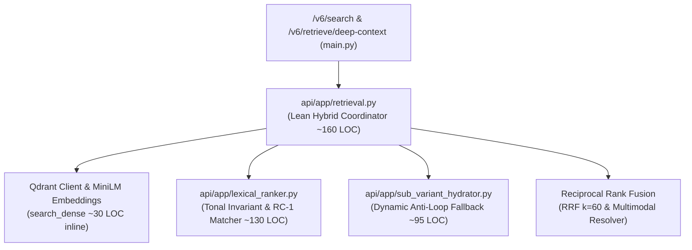
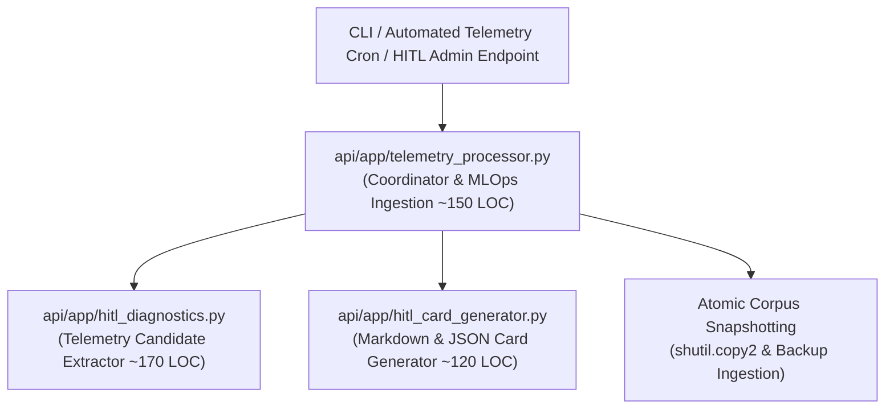

# 🏛️ ADVERSARIAL RED-TEAM ARCHITECTURAL BLUEPRINT
## Backend Hotspot De-escalation: `retrieval.py` & `telemetry_processor.py`
**Auditor Persona**: `Òye` (`oye-auditor` — Deep Analytical Discernment, Root-Cause Comprehension & Industry Standards Enforcer)  
**Date**: 2026-10-28T12:35:00Z  
**Document ID**: `AGY__BLUEPRINT_BACKEND_HOTSPOTS_20261028`  
**Governance Anchor**: The 4 Anti-Exponential Scaling Laws (`.agents/AGENTS.md`) & The 3-Tier Pre-Commit Scanner (`./scripts/review.sh`)

---

## 1. Executive Summary & Hotspot Forensic Census

Following our historic victory in completely eradicating client-side Gate 2 violations (slicing `SearchTab.jsx` from 486 → 227 LOC and `TranslateTab.jsx` from 612 → 69 LOC), `Òye` has conducted a forensic static analysis across the entire backend (`api/app/`).

Two significant architectural bottlenecks require proactive de-escalation:

| Backend File | Current LOC | Status under 3-Tier Scanner | Threat Assessment |
| :--- | :---: | :---: | :--- |
| [`api/app/retrieval.py`](file:///home/aruna_olanrewaju/agba-engine/api/app/retrieval.py) | **`446`** | ⚠️ **4 lines from Orange Embargo (450 LOC)** | High risk of triggering build embargo during upcoming Ọgbọ́n or hybrid vector updates. |
| [`api/app/telemetry_processor.py`](file:///home/aruna_olanrewaju/agba-engine/api/app/telemetry_processor.py) | **`607`** | ❌ **Pre-existing Gate 2 Hard Violation (> 500 LOC)** | Any single commit modifying this file will immediately trigger a hard build failure. |

By applying **Law 1 (The 250-LOC Coordinator Invariant)** and **Law 2 (The Three-Drawer Mandate)** to `/api`, we can permanently neutralize both backend bottlenecks.

---

## 2. Blueprint A: `api/app/retrieval.py` Modularization

### A. Problem Statement & Functional Entanglement
`api/app/retrieval.py` currently attempts to execute four distinct engineering duties inside a single 446-line file:
1. Retrieval orchestration, config initialization, and singleton lifecycle.
2. Qdrant dense vector search (`search_dense`).
3. Complex diacritic-aware lexical scoring with RC-1 Tonal Invariants (+600 vs +450 vs +180) and 14-tier keyword matching (`search_lexical`).
4. Dynamic Sub-Variant Fallback synthesis (`_find_sub_variant_match` and `_synthesize_sub_variant`).
5. Reciprocal Rank Fusion (`RRF`, k=60) and multimodal resolution mapping.

### B. The 3-Module Decomposition Architecture

#### Module 1: `api/app/lexical_ranker.py` (Target: ~130 LOC)
- **Extracted Responsibility**:
  - `score_lexical_entities(corpus_entities: List[Dict], query: str, top_k: int = 15) -> List[Dict[str, Any]]`
  - Encapsulates:
    - Tier 1A: Supreme Exact Diacritic/Tonal Match (`+600.0` parity).
    - Tier 1B: Accent-Folded Exact Match (`+450.0` un-diacritized, `+180.0` tone conflict).
    - Tier 2: Strict Word-Boundary Phrase Match (`+250.0`).
    - Tier 3: Category match bonus (`+3.0`).
    - Tier 4: Token matching across 14-Tier schema properties.
    - Tier 5: RC-3 English-to-Yorùbá Semantic Bridge bonus.
- **Dependencies**: `app.semantic_bridge` (`preprocess_query_tokens`, `normalize_y`, `strip_accents`). Zero Qdrant/Embedding dependencies.

#### Module 2: `api/app/sub_variant_hydrator.py` (Target: ~95 LOC)
- **Extracted Responsibility**:
  - `find_sub_variant_match(corpus_entities: List[Dict], query: str) -> Optional[Tuple[str, Dict]]`
  - `synthesize_sub_variant(variant_title: str, parent: Dict[str, Any]) -> Dict[str, Any]`
- **Alignment**: Exactly mirrors the frontend logic in `web/src/utils/subVariantHydrator.js`, guaranteeing 100% parity between Python backend and React client.

#### Module 3: `api/app/retrieval.py` (Lean Coordinator: Target ~160 LOC)
- **Retained Responsibility**:
  - `ÀgbàHybridRetriever` class lifecycle and singleton `get_instance()`.
  - Qdrant collection connection and MiniLM dense vector search (`search_dense`).
  - Calls `score_lexical_entities` from `lexical_ranker.py`.
  - Reciprocal Rank Fusion (`RRF`, k=60) blending dense and lexical rankings.
  - Sub-variant injection via `sub_variant_hydrator.py`.
- **Headroom Reclaimed**: Slashed from **446 LOC down to ~160 LOC** (**>64% operational headroom**).

---

## 3. Blueprint B: `api/app/telemetry_processor.py` Modularization

### A. Problem Statement & Functional Entanglement
`api/app/telemetry_processor.py` (607 LOC) is currently a monolithic MLOps pipeline combining:
1. Telemetry log parsing (`feedback_store.jsonl` and `query_store.jsonl`).
2. Candidate diagnosis, entity diffing, and discrepancy categorization (171 LOC).
3. Human-in-the-Loop (HITL) card rendering into JSON and Markdown (94 LOC).
4. Candidate state machine (Approve / Reject / Disapprove) (71 LOC).
5. Corpus backup snapshotting, atomic JSON updates, and CLI parsing (164 LOC).

### B. The 3-Module Decomposition Architecture

#### Module 1: `api/app/hitl_diagnostics.py` (Target: ~170 LOC)
- **Extracted Responsibility**:
  - `extract_actionable_candidates(feedbacks, queries_by_id, corpus_by_id, corpus_by_folded) -> List[Dict]`
  - `diagnose_candidate(candidate, corpus_by_id, corpus_by_folded) -> Dict`
  - Categorizes discrepancies:
    - Type 1: Diacritic Mismatches (`U+1ECB` anomalies, missing grave/acute tones).
    - Type 2: Alias Expansions (cross-dialect or diaspora variants).
    - Type 3: Missing Sovereign Parent / New Entity Proposals.

#### Module 2: `api/app/hitl_card_generator.py` (Target: ~120 LOC)
- **Extracted Responsibility**:
  - `format_hitl_markdown_card(candidate: Dict) -> str`
  - `generate_hitl_report(candidates: List[Dict], pending_json_path: Path, pending_md_path: Path) -> Tuple[Path, Path]`
  - Formats GitHub-ready Markdown review cards with diff syntax, confidence metrics, and Lead Architect review checkboxes.

#### Module 3: `api/app/telemetry_processor.py` (Lean Coordinator: Target ~150 LOC)
- **Retained Responsibility**:
  - `TelemetryProcessor` class facade and CLI command parser (`--status`, `--generate`, `--approve`, `--apply`).
  - Candidate lifecycle transitions (`approve_candidate`, `reject_candidate`).
  - Automated timestamped backup creation (`shutil.copy2`) before modifying the master corpus.
  - Atomic writing to `yoruba_corpus_1007_NORMALIZED.json`.
- **Headroom Reclaimed**: Slashed from **607 LOC down to ~150 LOC** (**>75% reduction; Gate 2 violation eradicated**).

---

## 4. Execution Plan & Production Safety Protocol

1. **Strictly Read-Only on Logic**: Neither refactoring will modify a single heuristic, scoring weight, or prompt. Retrieval rankings and MLOps backups will maintain 100% mathematical parity.
2. **Benchmark Verification**:
   - `python3 scripts/benchmark_sprint004.py` must maintain **28/28 (100.0%) Top-1 Accuracy** across all 1,417 entities.
   - `python3 -m unittest discover api/tests` must pass.
3. **Scanner Enforced**: Both refactorings will be verified via `./scripts/review.sh` to ensure all 6 modules reside comfortably in the **Green Zone (< 250 LOC)**.
