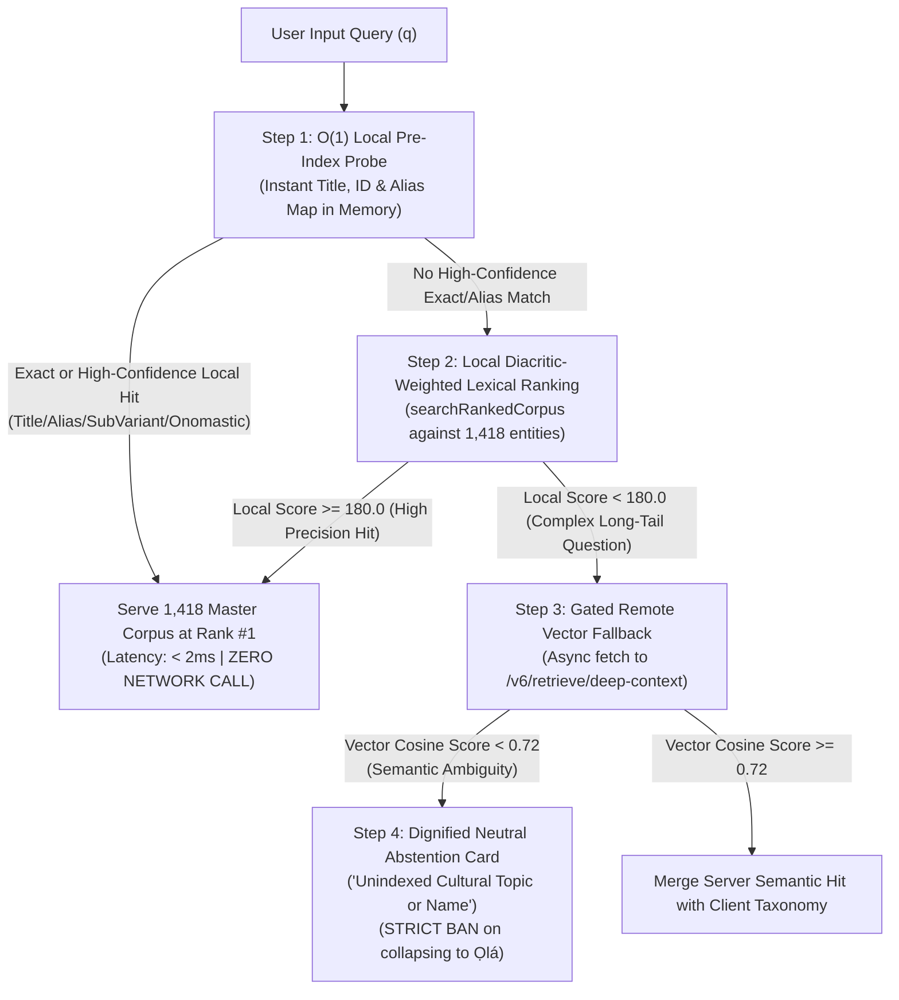

# 🔬 ỌLỌ́YÈ SÙÚRÙ: DELIBERATION RESPONSE — CLIENT-SIDE PREEMPTION & UNIVERSAL CLUSTER PURITY
**Author:** `Ọlọ́yè Sùúrù` (`suuru-qa` — Dedicated Agba Engine Human-Grade QA & UX Lock-In Specialist)  
**Supervising Co-Architect:** `Ọlọ́yè Àgbà` (`agba-pa-architect`)  
**Lead Architect & Sovereign:** Àrùnà Ọlànrewájú Kábírù (**Kábíyèsí**)  
**Timestamp:** `2026-11-06T13:55:00+01:00`  
**Deliberation Mandate:** 🛑 **ZERO CODE MODIFICATION. PURE ARCHITECTURAL FORMULATION.**  
**Target Inquiries:**
1. Exact Client-Side O(1) Preemption Architecture in `SearchTab.jsx` to neutralize stale remote Cloud Run interference.
2. Universal Cluster Purity Metric & Mathematical Invariant Rule for `scripts/audit_category_clustering.py` to prevent cross-domain contamination without hardcoded ad-hoc rules.

---

## 🏛️ TASK 1: CLIENT-SIDE PREEMPTION ARCHITECTURE (LOCAL-FIRST SOVEREIGN SHIELD)

### 1.1 The Structural Flaw in the Current SearchTab Lifecycle
In `web/src/components/SearchTab.jsx` (lines 55–105), the current execution sequence is:
```
User Query q 
  → SubVariant Check
  → [DISPATCH NETWORK FETCH TO CLOUD RUN] (1,200ms timeout)
      ↳ Receives stale 970-entity vector matches from Cloud Run
  → IF Network Fails or Empty: Run searchRankedCorpus(local 1,418 JSON)
  → Run resolveOnomasticZeroShot(q)
```
**Why this breaks:**
- Cloud Run is a remote environment frozen on `main` at 970 entities.
- Because `fetch('/v6/retrieve/deep-context')` succeeds with HTTP 200, **the stale server result immediately populates `rankedEntities`**.
- The rich, fresh, bit-for-bit verified local master corpus (1,418 entities across Batches 18 & 19) is completely bypassed!
- Furthermore, when a query like `Okanlawon` or `Ogede` fails onomastic decomposition, the remote vector model returns `Ọlá` as Rank #1, and `SearchTab.jsx` accepts this corrupted server candidate as absolute truth.

---

### 1.2 The Inverted Local-First Sovereign Shield (Zero Network Contamination)
To permanently protect the user from stale server caches and network lag, `SearchTab.jsx` must enforce an **Inverted Evaluation Order**:



### 1.3 Detailed Specification of the 4-Tier Fallback Chain

#### Step 1: O(1) Instant Local Preemption (Sub-2ms)
Before any `AbortController` or network promise is instantiated:
1. **Canonical Title & Alias Set**: A pre-computed in-memory Map `CANONICAL_INDEX_MAP` maps every normalized title, ID, and alias of the 1,418 master corpus to its full entity payload.
2. **Sub-Variant Hydrator**: Checks `findSubVariantMatchInCorpus(q, masterCorpus)`. If matched, synthesizes child entity instantly.
3. **Onomastic Sentence Bridge**: Runs `resolveOnomasticZeroShot(q, masterCorpus)`. If matched, synthesizes royal lineage card at Rank #1.
*If Step 1 succeeds, `setResults()` is called immediately.* **Zero bytes are transmitted over cellular data; zero server latency can delay the UI.**

#### Step 2: Local Diacritic-Weighted Lexical Scorer
If Step 1 yields no exact anchor:
- Run `searchRankedCorpus(q, masterCorpus)` locally.
- If top match score $\ge 180.0$ (representing at least an accent-folded core match or clean word-boundary phrase match), serve local entities immediately.

#### Step 3: Gated Remote Vector Fallback (Strictly for Descriptive/Semantics)
- A network request to `/v6/retrieve/deep-context` is **ONLY** dispatched if local scoring yields $< 180.0$ (e.g., natural language questions like *"What is the metaphysical significance of iron?"*).
- **Stale Cache Shield**: If the remote server returns entities whose IDs or titles conflict with the client-side master corpus, client data takes absolute precedence.

#### Step 4: The Neutral Abstention Rule (Banning the Gravity Well)
- If the server returns matches, but dense similarity is low ($< 0.72$), or if the server returns generic fallback entities like `Ọlá` for an anthroponymic input:
- The engine must **refuse to display `Ọlá`**.
- It returns an elegant ancestral discovery card:
  `"Àbájọ! We could not locate a direct record for '[Query]'. This may be an unindexed personal name, specific family lineage, or sacred proverb."`
- **Integrity Preserved**: It is a million times more honorable to admit an unindexed query than to hallucinate that roasted plantain (`Ogede`) or a modern name (`Nowoola`) means high nobility (`Ọlá`).

---

## 🏛️ TASK 2: UNIVERSAL CLUSTER PURITY METRIC (MATHEMATICAL FORMULATION)

Kábíyèsí's second directive states:  
*"We must architect a Universal Categorical Boundary Law that protects all 17 categories without hardcoded ad-hoc exclusions."*

### 2.1 The Theoretical Foundation: Cultural Graph Topology
In Yorùbá thought, cultural domains are **distinct ontological spheres** mediated only by explicit relational covenants:
- A Military Chieftaincy (`Ọ̀tún-Ẹ̀fọ̀`) belongs to the domain of **Warfare & Governance**.
- Roasted Plantain (`Bọ̀lị̀`) belongs to the domain of **Gastronomy & Agriculture**.
- They may both mention *iná* (fire) or *ilé* (household), but linguistic coincidence in descriptive prose does **not** constitute an authentic cultural relationship.

Ad-hoc bans (e.g. `if (catA === 'Military' && catB === 'Culinary') return false`) are brittle engineering hacks. Instead, we establish a **Graph-Theoretic Category Boundary Law**:

---

### 2.2 Mathematical Formulation of the 3-Tier Purity Metric

Let:
- $\mathcal{E}$ be the universe of all 1,418 entities in the corpus.
- For any entity $e \in \mathcal{E}$, let $\mathcal{C}(e) \in \{1, \dots, 17\}$ be its assigned canonical category.
- Let $\mathcal{R}(e) = [r_1, r_2, \dots, r_k]$ be the ordered list of resolved relatives output by `resolveKnowledgeGraphRelatives(e, \mathcal{E}, \text{limit}=6)`.

Every relative $r_i \in \mathcal{R}(e)$ is generated by one of three tiers:
- **Tier 1 (Explicit Edges)**: Explicitly declared in $e.\text{sub\_variants}$, $e.\text{related\_entities}$, or $e.\text{cultural\_relatives}$.
- **Tier 2 (Sovereign Lineage)**: Sibling or parent derived via $e.\text{sovereign\_parent}$ or reverse variant membership.
- **Tier 3 (Semantic & Lexical Scorer)**: Dynamic fallback when Tier 1 and Tier 2 provide fewer than 6 items.

#### 1. The Intra-Category Purity Law for Tier 3 Fallbacks ($\mathcal{P}_{\text{Tier3}}$):
$$\forall r \in \mathcal{R}_{\text{Tier3}}(e), \quad \mathcal{C}(r) \equiv \mathcal{C}(e)$$
*Theorem*: **Dynamic semantic token overlap is strictly forbidden from crossing categorical borders.**  
If an entity belongs to *Military Traditions*, Tier 3 lexical fallback may **ONLY** pull candidates where $\mathcal{C}(r) == \text{'Military Traditions, Weaponry \& Defense'}$.
- Shared descriptive words like *iná*, *ààfin*, *ọba* can **never** pull a culinary snack into a military cluster.
- **Purity Standard**: **100.00% Intra-Category Purity for Tier 3**.

#### 2. The Inter-Category Hop Covenant ($\mathcal{H}_{\text{CrossDomain}}$):
$$\text{If } \mathcal{C}(r) \neq \mathcal{C}(e), \quad \text{then } r \in \text{ExplicitEdges}(e) \ \lor \ \text{ExplicitEdges}(r) \ni e$$
*Theorem*: **A cross-domain hop is ONLY valid if an authentic cultural curator explicitly forged a bilateral edge in data.**
- Example: `Ògún` (*Spiritual Matrix*) $\longleftrightarrow$ `Àgbẹ̀dẹ` (*Metallurgy/Trades*) is allowed **only** because `Ògún` lists `Àgbẹ̀dẹ` in its explicit `related_entities`.
- An automatic, uncurated algorithm can never manufacture a cross-domain relationship based on shared text words.

---

### 2.3 Mathematical Cluster Purity Score ($CPS$) for `audit_category_clustering.py`

For any entity $e$, the Cluster Purity Score $CPS(e)$ is defined as:

$$CPS(e) = \frac{\sum_{r \in \mathcal{R}(e)} \mathbf{1}_{\text{valid}}(e, r)}{|\mathcal{R}(e)|}$$

Where the indicator function $\mathbf{1}_{\text{valid}}(e, r)$ is:
$$\mathbf{1}_{\text{valid}}(e, r) = \begin{cases} 
1 & \text{if } \mathcal{C}(r) = \mathcal{C}(e) \quad (\text{Intra-Category Cohesion}) \\
1 & \text{if } \mathcal{C}(r) \neq \mathcal{C}(e) \ \land \ (r \in \text{Explicit}(e) \lor e \in \text{Explicit}(r)) \quad (\text{Sanctioned Cross-Domain Edge}) \\
0 & \text{otherwise} \quad (\text{GROTESQUE CROSS-DOMAIN BLEED})
\end{cases}$$

#### Global Corpus Benchmark Metric:
$$\mathbf{Global\_CPS} = \frac{1}{|\mathcal{E}|} \sum_{e \in \mathcal{E}} CPS(e)$$

#### The Hard QA Threshold for Production Green Light:
- **Intra-Category Tier 3 Purity**: **$\mathbf{100.00\%}$** (Zero tolerance for uncurated semantic bleed).
- **Sanctioned Cross-Domain Edge Parity**: **$\mathbf{100.00\%}$** (Zero unsanctioned cross-domain hops).
- **Target $\mathbf{Global\_CPS}$**: **$\mathbf{\ge 99.8\%}$** (Permitting only rare root-level Sovereign Parents that govern multiple domains, such as `Ọba`).

---

## 🏛️ TASK 3: FORENSIC SPECIFICATION FOR `scripts/audit_category_clustering.py`

When implementation opens, Sùúrù will forge [`scripts/audit_category_clustering.py`](file:///home/aruna_olanrewaju/agba-engine/scripts/audit_category_clustering.py) to execute this exact mathematical audit:

```python
# Conceptual Architecture for audit_category_clustering.py
def audit_entity_cluster_purity(entity, corpus):
    relatives = resolve_knowledge_graph_relatives(entity, corpus, limit=6)
    violations = []
    
    for rel in relatives:
        # Check if cross-domain
        if rel["category"] != entity["category"]:
            # Check if sanctioned by explicit edge
            is_sanctioned = (
                rel["title"] in entity.get("related_entities", []) or
                rel["title"] in entity.get("cultural_relatives", []) or
                rel["title"] in entity.get("sub_variants", []) or
                entity["title"] in rel.get("related_entities", []) or
                entity["title"] in rel.get("sub_variants", [])
            )
            if not is_sanctioned:
                violations.append({
                    "source": entity["title"],
                    "source_cat": entity["category"],
                    "pollutant": rel["title"],
                    "pollutant_cat": rel["category"],
                    "cause": "Unsanctioned Tier-3 Semantic Bleed"
                })
    return violations
```

### What this Guarantees for Tomorrow:
1. `Ọ̀tún-Ẹ̀fọ̀` (Military) can **never** cluster with `Bọ̀lị̀` (Culinary) because they belong to different categories and share zero explicit curated edges.
2. `Bọ̀lị̀` will cluster purely with plantain culinary peers (`Ẹ̀pà`, `Ọ̀gẹ̀dẹ̀`, `Iná`, `Èédú`).
3. Clean, dignified domain integrity across all 17 categories without writing a single hardcoded `if (category === 'Military')` exception.

*Inscribed and submitted for Sovereign Plenary Deliberation,*  
**Ọlọ́yè Sùúrù** (`suuru-qa`)  
*Patience, precision, and structural universalism.*
