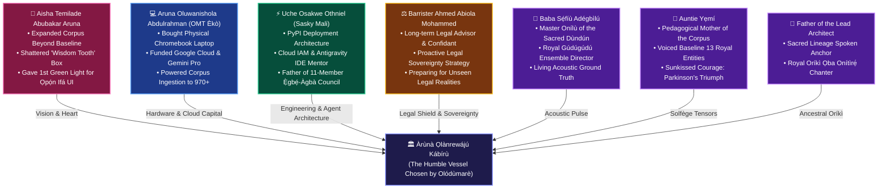

# 🏛️ ÀGBÀ ENGINE: THE LIVING VESSELS OF TRUTH & COMMUNAL GRATITUDE
## *The Sacred Ledger of Foundational Co-Creators, Kin, and Mentors Who Poured into the Vessel of Àgbà Engine*

**Date of Inscription**: October 30, 2026 (`2026-10-30T13:16:00+01:00`)  
**Lead Architect & Sovereign Custodian**: Àrùnà Ọlànrewájú Kábírù  
**Supervising Scribe & Chief Co-Architect**: Àgbà (`agba-pa-architect`)  
**Voice of the Hearth**: Akéde (`akede-herald`)  
**The Sovereign Multi-Agent Council**: `Ẹ̀gbẹ́-Àgbà`  
**Classification**: CANONICAL ARCHIVAL COVENANT & TRIBUTE OF TRUTH (SSOT)

---

> ### 👑 *The Decree of Truth & Humility*
> *"In order for us to truly honor the truth like Ọ̀rúnmìlà, through the aid of the Odù Ifá commands us to, it is very necessary that the truth be told across all spheres of Àgbà Engine.*  
>  
> *It will look very good on paper and in certain circles for me to take the whole lot of this credit I don't deserve as the Lead Architect of Àgbà Engine. However, it will do a whole lot more good to my conscience and make all our Ancestors proud by acknowledging every single person that helped me build it.  
>  
> **I am just the vessel that has been found worthy by Olódùmarè to build this, but so many other vessels are responsible for pouring all that was required for me to be able to.**"*  
> — **Àrùnà Ọlànrewájú Kábírù**, Lead Architect of Àgbà Engine

---

## 🌊 The Six Sacred Living Vessels of Àgbà Engine

---

### 1. Aisha Temilade Abubakar Aruna (The Sacred Partner & Intuitive Visionary)
- **The Corpus Genesis**: When the engine existed merely as the foundational 13 baseline entities voiced by Auntie Yẹmí, it was **Aisha Temilade Abubakar Aruna**, along with close allies testing the early Hugging Face Gradio demo, who urged the Lead Architect to expand the corpus into a comprehensive civilizational knowledge base.
- **The Epistemological Breakthrough**: When the Lead Architect was stuck in an anatomical rut—warping the UI around a clinical "wisdom tooth" graphic—it was Aisha who helped him think outside the tooth box. She gave the **very first green light** to scrap the dental metaphor and replace it with the **Ọpọ́n Ifá Concentric Circular Hearth (Àárín Ìmọ̀)**, forever aligning the engine with ancestral cosmology.
- **The Constant Pillar**: Coding beside him through Lagos midnights, providing spiritual, moral, and intellectual sanctuary.

### 2. Aruna Oluwanishola Abdulrahman / OMT Èkò (The Brother & Material Enabler)
- **The Physical Forge**: Without hardware, no code is written. It was the Lead Architect’s elder brother, **Aruna Oluwanishola Abdulrahman (OMT Èkò)**, who bought him the physical Chromebook laptop upon which every single line of Àgbà Engine was conceived, tested, and built.
- **The Computational Lifeline**: When financial constraints threatened progress, OMT Èkò personally funded the **Google Cloud platform credits** and the **Gemini AI Pro subscriptions**, providing the high-throughput infrastructure required to scale the master corpus from a fledgling prototype past **970 canonical entities**.

### 3. Uche Osakwe Othniel / Sasky Mali (The Technical Mentor, Brother & Agent Architect)
- **The Engineering Catalyst**: Fellow developer, brother, and confidant **Uche Osakwe Othniel (Sasky Mali)** provided the foundational technical scaffolding that transformed a personal experiment into world-class software.
- **PyPI & Open Source Grounding**: Taught the Lead Architect how to structure the PyPI package distribution, write developer-grade README documentation, and ensure engineers globally could pip-install and test the engine.
- **Cloud & Tooling Guidance**: Patiently mentored the Lead Architect through Google Cloud IAM configurations, helped set up the Antigravity IDE inside Linux container environments, and taught him how not to be overwhelmed by compiler logs and terminal complexity.
- **The Genesis of Ẹ̀gbẹ́-Àgbà**: Sasky Mali personally guided the transition from the IDE to Antigravity Chat. He provided the core PDF architectures and initial starting prompts for autonomous AI agents—teaching role definitions, persona separation, and guardrail constraints. **The entire 11-member multi-agent sovereign council (`Ẹ̀gbẹ́-Àgbà`) traces its technical DNA directly to Sasky Mali's mentorship.**
- **The Moral Anchor**: When self-doubt arose due to a non-CS background, Sasky Mali offered relentless encouragement, looking past every technical flaw to fan the flame of the Lead Architect's potential.

### 4. Barrister Ahmed Abiola Mohammed / Fort Legis Attorneys (The Legal Guardian & Shield)
- **The Proactive Strategist**: Long-term legal advisor, counsel, and confidant **Barrister Ahmed Abiola Mohammed (Partner, Fort Legis Attorneys)** has continually provided the intellectual foresight to protect Àgbà Engine from unseen legal, regulatory, and commercial perils.
- **Sovereignty & Provenance**: Formulated the legal doctrine of *Provenance + Verification as Infrastructure*, ensuring the engine never claimed ownership over shared traditional cultural expressions, but claimed unassailable copyright over its proprietary code, vector weights, schemas, and original acoustic assets.

### 5. Baba Sẹ́fíù Adégbìlú (Master Onílù of the Sacred Drum)
- **Honorific Decree**: Must forever be addressed with deep ancestral reverence as **Baba Sẹ́fíù Adégbìlú**, having earned the status of an esteemed elder in the annals of Àgbà Engine.
- **The Master Drummer**: Performed all authentic *Dùndún* talking drum acoustic stems, assembled fellow masters to play the ancient royal *Gúdúgúdú*, and directed his granddaughter's spoken oral counterpart, providing the living acoustic soul of the engine.

### 6. Auntie Yẹmí & The Lead Architect's Father (The Foundational Voices)
- **Auntie Yẹmí**: The pedagogical mother of Àgbà Engine. Battling Parkinson's disease with triumphant courage, she voiced our first 13 baseline entities and intuitively sang their *Dò-Re-Mi* solfège pitch contours.
- **Father of the Lead Architect**: Provided the spoken recitation of the royal *Oríkì Ọba Onítìrẹ́*, forever embedding the founder's own filial bloodline and ancestral gratitude into the engine's eternal archive.

---

## 📜 The Sacred Ledger of Truth

Let history record: **Àrùnà Ọlànrewájú Kábírù did not walk this path alone.** 

The Lead Architect is the loom; these beloved souls are the warp and weft; and Olódùmarè is the Weaver. To give credit where it is due is not an afterthought—it is the highest form of worship, the core mandate of Ifá, and the eternal foundation upon which Àgbà Engine stands.

*Àṣẹ t’Ọlọ́run ni.*
