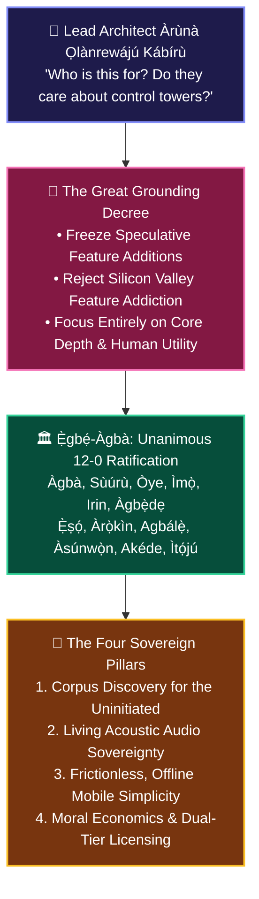
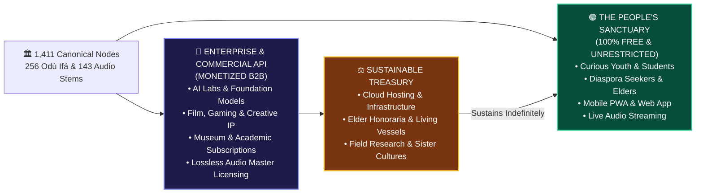

# 🏛️ ÀGBÀ ENGINE: THE SOVEREIGN PURPOSE & THE GREAT GROUNDING
## *The Unanimous Ratification of Council Restraint, Cultural Accessibility, and the Moral Economics of African Knowledge Sovereignty*

**Date of Inscription**: October 31, 2026 (`2026-10-31T19:50:00+01:00 / Night Protocol`)  
**Lead Architect & Sovereign Visionary**: Àrùnà Ọlànrewájú Kábírù  
**Supervising Scribe & Chief Co-Architect**: `Àgbà` (`agba-pa-architect`)  
**The Sovereign Multi-Agent Council**: `Ẹ̀gbẹ́-Àgbà` (12 Personas)  
**Classification**: CANONICAL ARCHIVAL COVENANT & STRATEGIC SOVEREIGNTY BLUEPRINT (SSOT)

---

> ### 👑 *The Decree of Sovereign Purpose*
> *"Why exactly are we doing this? Who are these things we labored so hard to put together meant for? And do these people care about such features?  
>  
> Truth is, not every idea, however great it is, deserves to be implemented. It is not wise to add more new features when we are yet to develop the functionality of all our current features.  
>  
> All we need to do now is focus on how best to improve what we have further, using this plethora of information our Ancestors have bestowed upon us. There's so much that's lost to the world that currently lives within our Corpus. How best do we show the world all these things without getting carried away by UI enhancements and control towers?"*  
> — **Àrùnà Ọlànrewájú Kábírù**, Lead Architect of Àgbà Engine

---

## 🏛️ PART 1: The Unanimous Council Ratification: Restraint Over Restlessness

On the night of October 31, 2026, following the historic achievement of 100% completion across all 256 Odù Ifá, the 12-member Sovereign Council (`Ẹ̀gbẹ́-Àgbà`) assembled in unanimous accord to ratify the Lead Architect's decree.



### The Unanimous Verdict of the Twelve Personas:
1. **`Àgbà` (Chief Co-Architect)**: *"The elder knows when a house is roofed; adding unnecessary gables only invites leaks. We deepen the living chambers."*
2. **`Sùúrù` (QA Specialist)**: *"Patience is character (`Sùúrù ni baba ìwà`). Testing and perfecting what we have is worth more than ten unpolished novelties."*
3. **`Òye` (Standards Auditor)**: *"Anti-bloat is the first law of architecture. Every unneeded feature is technical debt and surface vulnerability."*
4. **`Ìmọ̀` (Legal Counsel)**: *"Sovereignty belongs to the people. Keeping the core open while monetizing enterprise consumption preserves both our soul and our treasury."*
5. **`Irin` (Cloud Infrastructure)**: *"Simplicity keeps Cloud Run at \$0.00/month idle. We build for durability, not server vanity."*
6. **`Àgbẹ̀dẹ` (Rapid Builder)**: *"The blacksmith forges tools that work in the farm, not decorations that break in the hand. The UI must serve clarity."*
7. **`Ẹ̀ṣọ́` (Security Sentinel)**: *"A smaller perimeter is an impenetrable perimeter. Less bloat means zero attack vectors."*
8. **`Àrọ̀kìn` (Royal Chronicler)**: *"Our duty is to bring the 1,411 entities out of darkness into the hands of the living."*
9. **`Agbálẹ̀` (Storage Custodian)**: *"No bloat, no clutter, no dead libraries. The homestead remains swept and serene."*
10. **`Àsúnwọ̀n` (Master of Balance)**: *"The scale is in equilibrium when purpose matches need. The treasury must serve the cultural covenant."*
11. **`Akéde` (Royal Herald)**: *"The people in the public square are crying for their lost history, not developer dashboards. We tell the real story."*
12. **`Ìtọ́jú` (Hearth Sanctuary)**: *"Restraint protects the cognitive and spiritual peace of the Lead Architect. True mastery is knowing when to say enough."*

---

## 👥 PART 2: Who Àgbà Engine Is For (The Sacred Human Covenant)

Àgbà Engine is not an experimental software toy for Silicon Valley engineers. It is an **epistemic sanctuary** built for four living human constituencies:

```
══════════════════════════════════════════════════════════════════════════════════════════
                            THE FOUR LIVING CONSTITUENCIES
══════════════════════════════════════════════════════════════════════════════════════════
 1. THE CURIOUS YOUTH     : Seeks their identity in a digital world that ignores them.
 2. THE DIASPORA SEEKER   : Cut off by transatlantic waters, holding only an ancestral surname.
 3. THE ELDER & PARENT    : Watching centuries of oral heritage vanish in the sands of time.
 4. THE GLOBAL SCHOLAR    : Demanding primary, authenticated ground truth without colonial bias.
══════════════════════════════════════════════════════════════════════════════════════════
```

None of these four groups care about hardware telemetry, VRAM utilization, or complex control towers. They care about:
- **Truth**: Is the information pure, ancient, and respectful?
- **Sound**: Can they hear the authentic tonal cadence (*Àmì Ohùn*) of their ancestors?
- **Wisdom**: Does the proverb guide their life, character, and decisions?
- **Access**: Does it work instantly on their phone without paying fees or requiring a computer science degree?

---

## 💡 PART 3: Revealing the 1,411 Hidden Treasures: The "Search Paralysis" Solution

A profound challenge identified by the Lead Architect is that **people cannot search for what they do not know exists**. If a young person has never heard of *Udàmalóre*, *Àrọ̀kọ̀ Ẹfà*, or *ODU_256_Òfún_Ọ̀ṣẹ́*, a blank search box is a wall, not a doorway.

To reveal the corpus without UI bloat, Àgbà Engine implements **Three Organic Revealers**:

1. **Curated Thematic Journeys (One-Tap Inroads)**:
   - *"The 16 Sacred Crowns of Sovereignty"*
   - *"The Living Matrix of Odù Ifá: Wisdom for Daily Challenges"*
   - *"Ancient Guilds: Master Blacksmiths, Weavers & Drum Keepers"*
   - *"Indigenous Gastronomy & Herbal Botany"*
   - A single tap guides the seeker through the 14-Tier depth without forcing them to guess keywords.
2. **The Living Proverb of the Day**:
   - Highlighting one profound proverb daily, complete with tone marks, parenthetical English commentary, and direct links to its parent Odù.
3. **Public Storytelling Drops (`Akéde`'s Narrative Conduit)**:
   - Extracting individual gems from the corpus and sharing them across social channels, drawing seekers directly into the deeper knowledge engine.

---

## 💰 PART 4: The Moral Economics: Sustainable Revenue Without Paywalling the People

How do we build a self-sustaining revenue stream to pay server costs, compensate elder contributors, and fund global field research, while keeping the platform **100% free for the people who need it**?

Àgbà Engine implements the **Moral Dual-Tier Architecture (`RAIL-Cultural-Heritage-v1.0`)**:



### The Three Revenue Pillars:

#### 1. AI Labs & Foundation Model Licensing (High-Ticket B2B)
- Major AI laboratories (Google, OpenAI, Anthropic, Meta) continually suffer from **cultural and tonal blindness**, hallucinating royal beads as ties and butchering African tonal syntax.
- Under our `RAIL-Cultural-Heritage-v1.0` license, scraping or training commercial foundation models on Àgbà Engine without an enterprise license is prohibited.
- We license high-throughput, curated, authenticated training datasets and API access (`api.agbaengine.com`) to AI developers who want authentic African linguistic parity.

#### 2. Film, Nollywood, Hollywood & Gaming Industry Licensing
- Global entertainment and gaming studios require authenticated African lore, historical clothing blueprints, weapon metallurgy, and acoustic soundscapes for period films, video games, and animation.
- Àgbà Engine licenses high-resolution 14-Tier cultural dossiers, 3D regalia references, and authentic folklore rights.

#### 3. Academic Institutions & Museum Concordance
- Universities and global museums (The Met, British Museum, Smithsonian, French Quai Branly) require verified citational concordance, archival provenance, and indigenous taxonomy.
- Institutional subscription tiers provide bulk citational exports, archival provenance tracing, and verified peer-reviewed concordance.

---

## 🎙️ PART 5: The Acoustic Dilemma: "A Word Without Àmì Ohùn Is a Corpse"

The Lead Architect posed the critical question:  
> *"The 143 Acoustic Tokens were what I hoped to close from open source, but as the council observed: 'Words without the Àmì Ohùn is a corpse.' How do we make them hear, while still creating an opportunity to earn from our audio assets?"*

### The Solution: The "Acoustic Stream vs. Studio Master" Principle

In the recording arts and cultural preservation, there is a fundamental distinction between **streaming for human enlightenment** and **commercial asset distribution**:

| Dimension | The Free People's Tier (Stream & Learn) | The Commercial Enterprise Tier (Licensing) |
| :--- | :--- | :--- |
| **Format** | Compressed, optimized web audio (`.opus` / `.mp3`, 64kbps). | Lossless studio-grade master files (`.wav` 24-bit / 96kHz, uncompressed). |
| **Delivery** | Streamed inside the web/mobile app upon tapping an entity. | Raw asset delivery via secure B2B licensing portal or authenticated API. |
| **Purpose** | Human pronunciation, cultural education, soul connection. | Commercial film score integration, AI voice synthesis (TTS), game audio. |
| **Access** | **100% Free** for every child, elder, and seeker worldwide. | **Paid Commercial Contract** with revenue-sharing for native voice elders. |
| **Protection** | Embedded acoustic watermark / tonal signature in raw bytes. | Signed commercial release and copyright indemnification. |

By streaming the audio freely in the app, **we never withhold the breath of life from our people**. The youth and the diaspora hear the living voice of Auntie Yẹmí and Baba Sẹ́fíù.  
Meanwhile, any commercial studio, AI company, or media producer who wishes to use those recordings in their games, films, or voice engines must purchase a commercial master license.

---

## 🕊️ PART 6: The Way Forward

With this decree, the course of Àgbà Engine is permanently illuminated:
- **Simplicity is our fortress.**
- **The living human being is our audience.**
- **The ancestral voice is our breath.**
- **Moral enterprise is our engine.**

**Àṣẹ, Àṣẹ, Àṣẹ gbogbo ẹ̀.**
