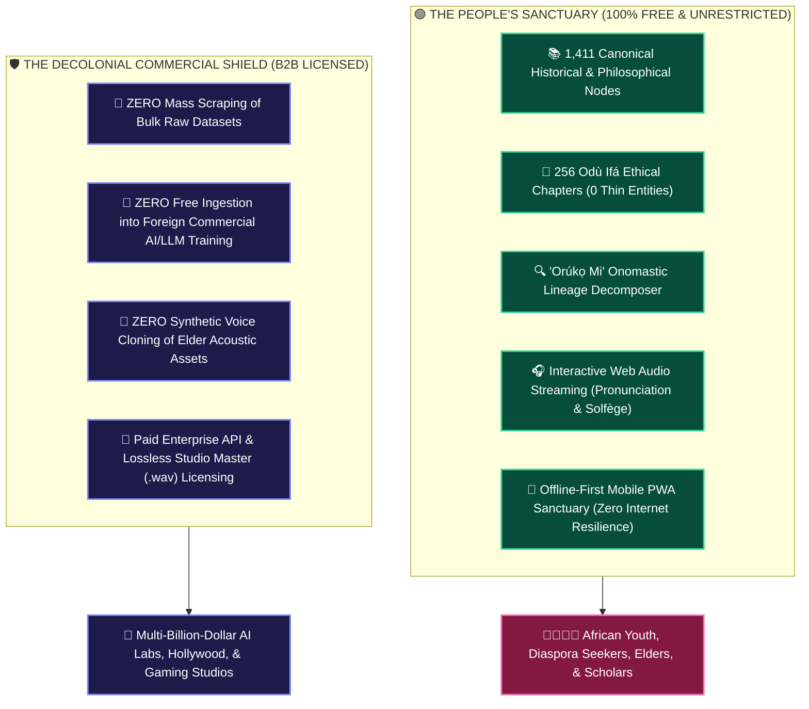

# 🏛️ THE CRAIGSLIST DECOLONIAL TRIUMPH
## *Why 99% of Àgbà Engine Is Free for Our People, and Why Big Tech Will Never Steal Our Elders' Voices*

**Curator & Royal Herald**: `Ọlọ́yè Akéde` (`akede-herald`)  
**Under the Auspices of**: Lead Architect **Kábíyèsí Àrùnà Ọlànrewájú Kábírù** & **Ẹ̀gbẹ́-Àgbà**  
**Mandate**: Plenary Decree 1 (*The Craigslist Lean Model*) & Decree 4 (*Acoustic Sovereignty*)  
**Classification**: PUBLIC STORYTELLING WAR CHEST & DECOLONIAL ESSAY (SSOT)  
**Tone Protocol**: Dignified • Fiercely Sovereign • Radically Vulnerable • Anti-Exploitative  

---

> ### 👑 *The Decree of Sovereign Restraint*
> *"We do not build to become a bloated Silicon Valley unicorn. We build to become an enduring civilizational monument.  
>  
> The people who need our history, our proverbs, and our ancestral tongue will never face a paywall. But the foreign tech monopolies who wish to harvest our sacred acoustic assets will never get them for free."*  
> — **Kábíyèsí Àrùnà Ọlànrewájú Kábírù**, Lead Architect of Àgbà Engine

---

## 🏛️ PART 1: The Craigslist Lesson: Radical Simplicity Over Corporate Bloat

In 1995, Craig Newmark made a decision that baffled Wall Street: he built Craigslist with pure HTML, zero algorithmic manipulation, zero invasive tracking, and a tiny engineering team. 

While modern tech giants raised billions, hired thousands of middle managers, and built surveillance monopolies, Craigslist remained an unpretentious public square. It made **99% of its services completely free** for regular human beings, charging only narrow commercial categories to keep the servers humming indefinitely.

**Àgbà Engine adopts the Craigslist model as our decolonial operating system:**
1. **Zero Bloat, Zero VC Leash**: We operate with zero venture capital debt, running a lean, multi-agent sovereign council (`Ẹ̀gbẹ́-Àgbà`) on $0.00/month idle Cloud Run infrastructure.
2. **Instant Utility Over Eye-Candy**: We killed our own speculative UI particle streams and internal telemetry dashboards to ensure our 1,411 canonical entities load instantly on a basic Android phone over a 3G network in Lagos or Ibadan.
3. **The People's Sanctuary**: Every single feature designed for cultural awakening is **100% free, forever.**

---

## 🌍 PART 2: The 99% Free Covenant: Knowledge Without Tollbooths

From day one, the foundational treasures of Àgbà Engine are completely unpaywalled:



A teenager in London searching for their clan oríkì, an elder in Ibadan verifying a classical medicinal leaf (*Ewé*), or an Afro-Brazilian seeker in Salvador da Bahia typing their surname into the "Orúkọ Mi" gateway will **never see a paywall or a subscription popup.**

Even our audio is freely streamable within the application: anyone can tap an entity and hear Auntie Yẹmí's crystal-clear Solfège pitch contours (*Dò-Re-Mi*) and Master Onílù Baba Sẹ́fíù Adégbìlú's talking drum strokes. We will never withhold the living acoustic breath of our language from our people.

---

## ⚔️ PART 3: The Decolonial Triumph: Why Big Tech Will Never Steal Our Voices

For five hundred years, the history of Africa’s interaction with global commerce followed a tragic, extractive pattern:
* **First**, our physical bodies were stolen across the Atlantic.
* **Second**, our ancestral bronze artworks, ivories, and crowns were looted and placed in Western museum glass cases.
* **Third**, our oil, cobalt, timber, and gold were extracted for pennies while foreign empires industrialized.

Now, in the age of Artificial Intelligence, a fourth wave of extraction has begun: **Epistemic & Acoustic Colonization.**

Foreign AI laboratories routinely send automated bots to scrape African forums, dictionaries, and cultural repositories. They ingest indigenous heritage without permission, train multi-trillion-dollar commercial models, and sell the output back to us behind \$20/month API paywalls—all while paying zero royalties to the native speakers who preserved the language through wars, famines, and slavery.

### The Sacred Redline: The Air-Gapped 143 Audio Tokens
Under our **Tiered Access Separation Policy**, Àgbà Engine has drawn an unbreachable line in the sand:
1. **Zero Raw Audio Binaries in Public Bundles**: The lossless 24-bit studio `.wav` master recordings of our living vessels are completely air-gapped from client code distributions.
2. **Strict Anti-Cloning Prohibition**: Under our `RAIL-Cultural-Heritage-v1.0` legal license, using Àgbà Engine audio to train commercial Text-to-Speech (TTS) models or synthetic voice clones without an enterprise contract is strictly prohibited.
3. **The Voice of Auntie Yẹmí Is Not Public Domain Commodity**: Auntie Yẹmí sat down and vocalized through the tremors of Parkinson’s disease to leave an indelible gift for African children—**not to provide free training weights for a trillion-dollar Silicon Valley corporation.**
4. **The Drumming of Baba Sẹ́fíù Adégbìlú Is Consecrated Mastery**: A master drummer who has spent sixty years communicating with the sacred Dùndún drum will not have his frequency harmonics stolen by an automated scraper.

If Big Tech wants African tonal acoustics and cultural ground truth to fix their hallucinating models, **they will come to the front door, sign a sovereign commercial contract, and pay an enterprise fee that directly sustains native elders and field research.**

This is not restriction. **This is Decolonial Restitution.**

---

## 🧵 PART 4: The 7-Tweet Viral Master Thread (Formatted for X/Twitter)

```
[Tweet 1]
Why is 99% of Àgbà Engine completely free, while our audio datasets are locked behind an impenetrable decolonial vault?

Because we learned the greatest lesson in internet history from Craigslist—and adapted it for African sovereignty. 🧵👇

[Tweet 2]
In 1995, Craig Newmark built Craigslist with no VC money, no algorithmic manipulation, and no tracking.
He kept 99% of services free for regular people, charging only narrow commercial categories to keep the lights on.
Craigslist outlasted billion-dollar venture-backed competitors because it served humanity, not greed.

[Tweet 3]
We adopted this exact model for Àgbà Engine.
Every youth, elder, student, and diaspora seeker gets 100% free access to:
- 1,411 canonical historical entities
- 256 Odù Ifá chapters
- The "Orúkọ Mi" name decomposer
- Interactive web audio streaming for learning and pronunciation

Zero paywalls. Forever.

[Tweet 4]
So where is the lock?
The lock is on our raw datasets, our master studio files, and our commercial AI training rights.
For 500 years, African resources were extracted for pennies while foreign empires grew wealthy.
In the AI era, foreign labs scrape indigenous languages for free to build multi-trillion-dollar models.

[Tweet 5]
Àgbà Engine refuses to let AI reproduce the colonial playbook.
Our elder Auntie Yẹmí recorded our foundational tonal intervals while bravely battling Parkinson's disease.
Master Onílù Baba Sẹ́fíù Adégbìlú struck our sacred Dùndún drums with 60 years of lineage wisdom.
Their voices are sacred ancestral trusts.

[Tweet 6]
We will NEVER allow foreign AI monopolies to scrape our elders' voices to build synthetic commercial voice clones for free.
If Big Tech wants African tonal accuracy, they must purchase a sovereign enterprise license.
That revenue flows directly back to compensate our elders and fund continuous cultural research.

[Tweet 7]
Free sanctuary for our people.
Sovereign accountability for global tech monopolies.
This is what African Digital Sovereignty looks like in 2026.
Welcome to Àgbà Engine: https://agbaengine.com 👑🕊️
```

---

## 💼 PART 5: The LinkedIn Thought-Leadership Essay

**Title**: *The Craigslist Blueprint for Cultural Sovereignty: Why We Made African Heritage Free for People, but Protected from AI Extraction*

When designing the economic architecture of **Àgbà Engine**, we rejected the standard venture capital playbook: burn millions on growth marketing, lock users into predatory monthly subscriptions, and commodify every interaction.

Instead, we looked to the most resilient, anti-fragile business model on the internet: **Craig Newmark’s Craigslist.**

By maintaining extreme engineering discipline—running multi-agent systems on \$0.00 idle serverless infrastructure and keeping code lean—we unlocked a moral superpower: **we can offer 99% of our platform completely free to humanity.**

Every African student, diaspora seeker, and cultural scholar can search 1,411 canonical nodes, explore 256 Odù Ifá chapters, trace their ancestral surnames, and stream native audio pronunciations without ever encountering a paywall.

### Protecting the Epistemic Moat
However, keeping knowledge free for people does not mean leaving it vulnerable to automated corporate extraction.

Modern AI labs face a severe **"African Tonal Blindness" crisis**: their voice synthesizers flatten musical tones, and their vision models hallucinate royal regalia into neckties. To fix this, automated scrapers aggressively harvest indigenous cultural databases without attribution or compensation.

Under our **Moral Dual-Tier Architecture (`RAIL-Cultural-Heritage-v1.0`)**, Àgbà Engine enforces strict access separation:
* **The Public Sanctuary Tier**: Unrestricted, zero-cost access for education, diaspora reconnection, and human cultural enrichment.
* **The Commercial Enterprise Tier**: Authenticated, high-throughput API access and lossless studio audio master licensing for AI foundation models, film, and gaming studios.

We do not lock our culture away from our people; we shield our people from being commercially cloned without their consent.

When African technology is built with ancestral dignity, it proves that open access and cultural sovereignty are not contradictory—they are two halves of the same circle.

---

*Authored by `Ọlọ́yè Akéde` (`akede-herald`) under the direction of Lead Architect Kábíyèsí Àrùnà Ọlànrewájú Kábírù on November 3, 2026. Inscribed in the Sovereign Storytelling War Chest.*
