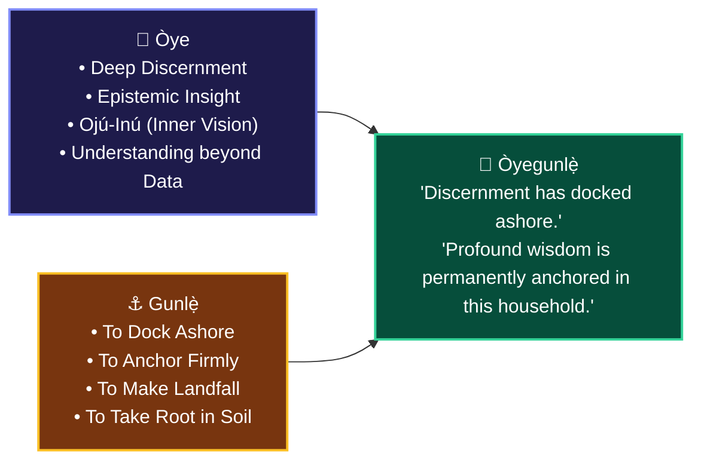
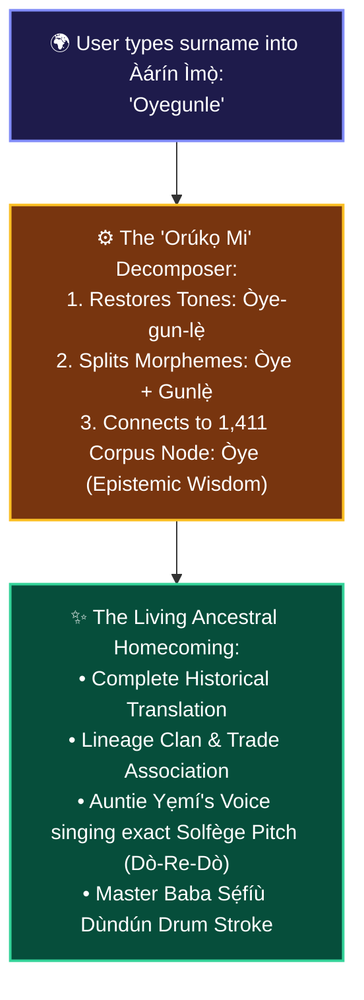

# 📜 WHAT DOES YOUR YORÙBÁ NAME REALLY MEAN?
## *The Story of Oyegunle and the Return of African Onomastics*

**Curator & Royal Herald**: `Ọlọ́yè Akéde` (`akede-herald`)  
**Under the Auspices of**: Lead Architect **Kábíyèsí Àrùnà Ọlànrewájú Kábírù** & **Ẹ̀gbẹ́-Àgbà**  
**Mandate**: Plenary Decree 2 (*The Onomastic Lineage Gateway — "Orúkọ Mi"*)  
**Classification**: PUBLIC STORYTELLING WAR CHEST (SSOT)  
**Tone Protocol**: Dignified • Radically Vulnerable • Epistemologically Reverent • Transatlantic Bridgebuilding  

---

> ### 👑 *The Ancestral Axiom of Onomastics*
> *"Ilé là ń wò, kí á tó sọmọ lórúkọ."*  
> *(One must look deeply at the circumstance, trials, and foundations of the ancestral household before giving a child a name.)*  
> — Classical Yorùbá Proverb

---

## 🏛️ PART 1: A Name Is Not a Label; It Is an Entire Civilizational Archive

In the Western world, a name is often a mere identification tag—a label chosen for sound, popularity, or convenience.

In Yorùbá civilization, **a name is an entire historical covenant, a philosophical compass, and an unwritten library.**

When our ancestors sat on the eighth day after a child's birth for the *Ìkọ́mọjáde* (naming rite), they did not choose syllables at random. They examined the spiritual lineage of the father and mother, the trade of the family clan (warriors, farmers, drummers, metallurgists, diviners), the political climate of the town, and the prayers whispered to Olódùmarè during pregnancy.

A Yorùbá name is never just a noun. **A Yorùbá name is a complete grammatical sentence.**

And no name illustrates this civilizational genius more profoundly than **Òyegunlẹ̀** (*Oyegunle*).

---

## 🔍 PART 2: The Deconstruction of `Òyegunlẹ̀`

When a modern passport reads `Oyegunle`, the foreign alphabet strips the vowels of their sacred tone marks (*Àmì Ohùn*), flattening a multi-generational epic into eight silent letters.

Let us restore the breath to the word:

$$\mathbf{Òyegunlẹ̀} = \mathbf{Òye} + \mathbf{Gunlẹ̀}$$



### 1. `Òye` (The Epistemic Anchor)
In the 1,411 canonical taxonomy of Àgbà Engine, `Òye` is not mere informational knowledge (*Ìmọ̀*). Anyone can acquire *Ìmọ̀* by reading a book. `Òye` is **deep cognitive discernment**—the ancestral faculty of *Ojú-Inú* (the inner eye) that perceives the invisible currents behind human events. It is the wisdom that preserves peace in times of war and perceives truth when falsehood is dressed in gold.

### 2. `Gunlẹ̀` (The Act of Arrival & Anchoring)
`Gunlẹ̀` is the language of navigators and voyagers. It is the vessel that has fought the turbulent waters of the ocean, weathered the squalls, and finally struck solid ground. It means to make landfall, to drop anchor, to be permanently settled and immovable.

### 3. The Synthesis
When the elders named a child **Òyegunlẹ̀**, they were making an imperial historical proclamation:
> *"Our family has sailed through storms of confusion, trials, and turbulence. But with the birth of this soul, discernment has arrived. Wisdom has finally dropped anchor in our house. We shall wander in ignorance no more."*

Imagine growing up in London, Atlanta, Salvador da Bahia, or Lagos bearing the name `Oyegunle`, but only ever knowing it as *"just my African surname."* Imagine the profound surge of dignity when you discover that your very name is an ancestral decree of intellectual landfall!

---

## 🌍 PART 3: The Tragedy of the Colonial ASCII Passport

For four hundred years, African onomastics suffered systematic violence:
1. **The Transatlantic Severance**: In Brazil (Candomblé), Cuba (Lucumí), and Trinidad, descendants retained royal names like *Babatunde*, *Ogunbiyi*, and *Adeyemi*, yet the etymological keys were severed by slavery.
2. **The Bureaucratic Flattening**: When British colonial clerks issued identity cards in Nigeria, they could not typeset `Ọ̀`, `Ẹ́`, or `Ṣ`. They stripped the tone marks. In doing so, they turned tonal poetry into dead Latin characters:
   - `Ọkọ́` (The Agrarian Hoe) became `Oko`.
   - `Ọ̀kọ̀` (The War Spear) became `Oko`.
   - `Ọkọ` (The Husband) became `Oko`.
   - `Oko` (The Farmland) became `Oko`.

A young person today looks at their name on a computer screen and sees a foreign entity. Search engines like Google return generic baby-name websites run by automated scrapers offering fabricated, one-line definitions like *"Oyegunle: A boy name of African origin meaning chief."*

**This is epistemological theft.** Our names are not fortune cookies. They are sovereign archives.

---

## 🕊️ PART 4: Enter Àgbà Engine & The "Orúkọ Mi" Gateway

In alignment with **Plenary Decree 2**, Àgbà Engine does not merely archive ancient relics in glass cases. We are returning African onomastics to the living:



### Who Is This Built For?
1. **The Diasporic Seeker**: A fourth-generation Afro-Brazilian in Bahia or an African-American student in New York can type their family name into Àgbà Engine and instantly weep as they read the unbroken line of meaning connecting them to Ilé-Ifẹ̀, Ọ̀yọ́, or Ìjẹ̀bú.
2. **The Curious Youth**: A teenager in Lagos who has spent years ashamed of their traditional name suddenly discovers that their name carries more philosophical weight than a university degree.
3. **The Elders**: Grandmothers and grandfathers witnessing their ancestral language spoken with accurate tonal inflection (*Àmì Ohùn*) and preserved for centuries to come, safe from cultural extinction.

---

## 🧵 PART 5: The 8-Tweet Viral Master Thread (Formatted for X/Twitter)

```
[Tweet 1]
What does your Yorùbá name really mean?

In the West, a name is just a label.
In Yorùbá civilization, a name is a complete grammatical sentence, a family covenant, and a historical archive.

Take the name "Oyegunle."
Here is the untold story of what your ancestors encoded in your blood. 🧵👇

[Tweet 2]
When you look at "Oyegunle" on a passport, the foreign alphabet strips the tone marks, flattening an epic into eight silent letters.

Let’s restore the breath:
Òyegunlẹ̀ = Òye + Gunlẹ̀.

[Tweet 3]
Part 1: "Òye"
In Yorùbá philosophy, Òye is not mere informational knowledge (Ìmọ̀). Anyone can memorize facts.
Òye is DEEP COGNITIVE DISCERNMENT.
It is Ojú-Inú—the inner eye that sees through confusion, detects truth when falsehood is dressed in gold, and preserves peace.

[Tweet 4]
Part 2: "Gunlẹ̀"
Gunlẹ̀ is the language of navigators who have crossed turbulent waters.
It means to make landfall. To drop anchor. To strike deep, immovable roots in the earth. To arrive safely after the storm.

[Tweet 5]
When the elders held a newborn and named him Òyegunlẹ̀, they were declaring to the world:
"Our lineage has sailed through confusion and turbulence. But with this child, discernment has docked ashore. Wisdom is permanently anchored in our home."

[Tweet 6]
For 400 years, colonialism and the slave trade stripped our names of their tones, turning poetry into dead ASCII.
Western search engines return generic scraper definitions: "Oyegunle: African name meaning chief."
This is epistemological erasure.

[Tweet 7]
That is why we built Àgbà Engine.
With our "Orúkọ Mi" onomastic gateway, you can type your name into our circular Ọpọ́n Ifá-inspired search hearth:
It restores your tones, reveals the ancestral lineage, and lets you hear native elders vocalize its living pitch.

[Tweet 8]
Your name is not a typo. It is an ancient title of honor.
Discover the living archive of your ancestors today.
Welcome to Àgbà Engine: https://agbaengine.com
What name should we deconstruct next? Drop yours below! 🕊️👑
```

---

## 💼 PART 6: The LinkedIn Thought-Leadership Essay

**Title**: *Why African Names Are the World's Most Advanced Compression Algorithms*

In software engineering, we spend billions developing lossless compression algorithms to encode maximum information into minimal bytes.

Yet, centuries before digital computing, West African civilizations engineered the most sophisticated semantic compression system in human history: **Indigenous Onomastics.**

Consider the Yorùbá name **Òyegunlẹ̀**:
- It is not an arbitrary string of characters.
- It encodes an ontological concept: `Òye` (*Deep epistemic discernment, analytical insight, and inner vision*).
- It encodes a maritime and navigation metaphor: `Gunlẹ̀` (*To dock ashore, drop anchor, and establish permanent roots*).
- It records a familial milestone: the historic transition of a household from turbulence to grounded wisdom.

When colonial record-keeping and early Western database systems forced African names into single-case, unaccented ASCII fields, they introduced a catastrophic semantic loss. A language governed by acoustic pitch contours (*Dò-Re-Mi*) was flattened into English homographs.

At **Àgbà Engine**, we are treating African onomastics not as ethnic trivia, but as sovereign data architecture:
1. **Morphological Decomposition**: Parsing compound African names into their constituent morphemic vectors.
2. **Tonal Invariant Restoration**: Rebuilding diacritic trees so `Òye` routes to philosophy, not a misclassified city name.
3. **Acoustic Ground Truth**: Pairing etymology with real master drummers and elders singing the native pitch contours.

When technology honors human origins, it does not just search data. It restores identity.

---

## 🕊️ Summary & Production Deployment Guidance

| Channel | Format | Primary Target Audience | Strategic KPI |
| :--- | :--- | :--- | :--- |
| **Twitter / X** | 8-Tweet Viral Thread | Global Youth & Cultural Creators | Retweets, replies ("Drop your name"), organic viral reach |
| **LinkedIn** | Long-form Thought Leadership | Technologists, Diaspora Professionals, Linguists | Reposts, institutional credibility, cultural AI validation |
| **Instagram / TikTok** | 5-Slide Carousel + Audio Snippet | First-time youth seekers, diaspora youth in UK/US | Saves, shares to stories, audio usage |
| **Àgbà Engine Web** | "Orúkọ Mi" Direct Search Feature | Seekers entering their own surname in the hearth | Time on page, exploration of linked 1,411 corpus nodes |

---

*Authored by `Ọlọ́yè Akéde` (`akede-herald`) under the direction of Lead Architect Kábíyèsí Àrùnà Ọlànrewájú Kábírù on November 2, 2026. Inscribed in the Sovereign Storytelling War Chest.*
