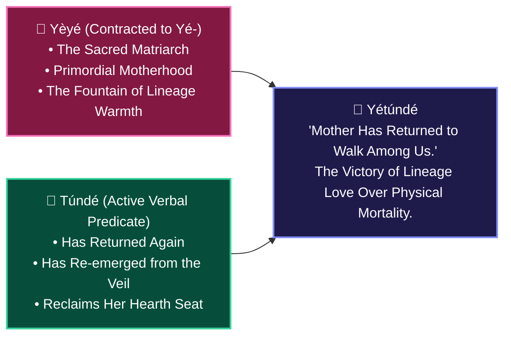

# 📜 THE REBIRTH OF THE MOTHER: DECODING YÉTÚNDÉ & ANCESTRAL REINCARNATION
## *How African Onomastics Conquered Mortality and Transformed Grief into Song*

**Curator & Royal Herald**: `Ọlọ́yè Akéde` (`akede-herald`)  
**Under the Auspices of**: Lead Architect **Kábíyèsí Àrùnà Ọlànrewájú Kábírù** & **Ẹ̀gbẹ́-Àgbà**  
**Mandate**: `CHECKIN-AKEDE-004` & Plenary Decree 2  
**Classification**: PUBLIC STORYTELLING WAR CHEST & VIRAL REPERTOIRE (SSOT)  
**Tone Protocol**: Dignified • Deeply Moving • Culturally Grounded • Transatlantic Bridgebuilding  

---

> ### 👑 *The Sacred Axiom of Ancestral Continuity*
> *"Àtúnwá ni ọmọ; ẹni tí ó bá fi ọmọ rere sílẹ̀ kò kú tán."*  
> *(A child is living reincarnation; one who leaves noble descendants across the earth never completely perishes.)*  
> — Classical Yorùbá Proverb

---

## 🏛️ PART 1: The Day Grief Turned into a Lullaby

In Western culture, death is often treated as a linear tragedy—a final curtain followed by an empty silence.

In classical Yorùbá civilization, **death is merely a temporary veil, and love is an unbreakable homing beacon.**

Imagine an ancient family compound in Ilé-Ifẹ̀, Ọ̀yọ́, or Ìjẹ̀bú. The revered matriarch—the grandmother whose calm hands resolved disputes, whose prayers guarded the children, and whose laughter warmed the hearth—has completed her earthly journey and crossed into the ancestral realm (*Ọ̀run*). 

The compound is heavy with grief.

Then, weeks or months later, the cry of a newborn baby girl pierces the dawn.

The elders gather for the naming rite (*Ìkọ́mọjáde*). They look into the infant’s eyes. They observe the calm, unhurried gaze, the unmistakable gentle arch of the brow, the familiar warmth. The elders smile through their tears. The master drummer strikes the tension cords of the Dùndún talking drum, and the family declares:

$$\mathbf{Yétúndé} = \mathbf{Yèyé} + \mathbf{Túndé}$$

**"Mother has returned again to walk among us."**

In that single instant, mourning is conquered. The funeral clothes are laid aside; the songs of welcome begin. The matriarch did not vanish into an abstract void; she renewed her covenant with her lineage.

---

## 🔍 PART 2: The Morphological Architecture of `Yétúndé`

In Àgbà Engine’s 5-Class Onomastic Engine, `Yétúndé` belongs to **Class D: Contracted Ancestral Return Names (*Orúkọ Àtúnwá*)**:



### The Sibling Names of Reincarnation:
* **`Bàbátúndé` (`Bàbá` + `Túndé`)**: *"The Patriarch, the compound pillar, has returned."*
* **`Yéwándé` (`Yèyé` + `Wá-mi-dé`)**: *"Mother searched for me across the ancestral veil and arrived safely."*
* **`Yéjídé` (`Yèyé` + `Jí-dé`)**: *"Mother has awoken again in our midst."*
* **`Ìyábọ̀` (`Ìyá` + `Bọ̀`)**: *"The Mother has arrived home."*

This is not superstition; it is **deep spiritual psychology**. It binds the generations together in an unbroken circle of reverence. A child named `Yétúndé` grows up knowing that she is treated with immense gentleness because she carries the soul-memory of the family’s foundation.

---

## 🌍 PART 3: The Transatlantic Survival: From Bahia to Brooklyn

During the brutality of the Middle Passage, enslavers stripped African captives of their clothes, their drums, and their freedom. But they could not reach into their minds to erase their names.

Across the African diaspora, the memory of `Yétúndé` refused to die:
* In **Salvador da Bahia, Brazil**, Candomblé priestesses whispered *"Iya"* and *"Yetunde"* in sacred songs.
* In **Cuba**, Lucumí oral liturgies preserved the reverence for ancestral return.
* In **the United States and the United Kingdom**, thousands of young women carry the name *Yetunde*, often without knowing the breathtaking civilizational epic encoded in their birth certificate.

For centuries, Western baby-name websites described `Yetunde` as: *"African girl name meaning mother."*

This is the tragedy of ASCII flattening. It strips the tonal music (`Yétúndé`), strips the grammar, and erases the philosophy.

---

## ✨ PART 4: How Àgbà Engine Restores `Yétúndé`

Today, in Àgbà Engine, when a seeker in Chicago, London, or Lagos types `Yetunde` into the search hearth:
1. **The Golden Lineage Ribbon Illuminates**: The UI displays the glowing golden morphemic ribbon decomposing `Yé` (Mother) and `Túndé` (Has returned).
2. **Sovereign Parent Routing**: It automatically routes Rank #1 to the primary sovereign node: **`Ìyá`** (The Primordial Matriarch), opening the gateway to 14-Tier historical essays, royal court etiquette, and dual-language proverbs.
3. **The Living Spoken Voice**: The seeker can tap and hear Auntie Yẹmí singing the exact tonal inflection (*Dò-Re-Dò*), restoring the authentic cadence of African speech.

Your name is not a typo. **Your name is an ancestral victory.**

---

## 🧵 PART 5: The 8-Tweet Viral Master Thread (Formatted for X/Twitter)

```
[Tweet 1]
If your name is Yetunde, Babatunde, or Yewande, your ancestors didn't just give you a name.

They used your birth to conquer death.

Here is the untold story of African reincarnation, onomastics, and the rebirth of the mother. 🧵👇

[Tweet 2]
In the West, death is often treated as a final, permanent tragedy.
In classical Yorùbá civilization, death is merely a temporary veil, and love is an unbreakable homing beacon.

[Tweet 3]
When a beloved grandmother or mother passed away, the family compound mourned deeply.
But when the next baby girl was born, the elders looked into her eyes, saw the calm, gentle gaze of the matriarch, and declared:
"Yétúndé."

[Tweet 4]
Yétúndé is a complete sentence:
Yèyé (Mother) + Túndé (Has returned again).

"Mother has returned to walk among us."
In that single proclamation, mourning turned to celebration. The funeral clothes were put away.

[Tweet 5]
Notice the grammatical precision:
- Yétúndé: Mother has returned
- Bàbátúndé: Father has returned
- Yéwándé: Mother sought me out across the veil and arrived
- Ìyábọ̀: Mother has arrived home

A culture that refuses to let love die.

[Tweet 6]
For 400 years, foreign records stripped the tone marks:
Yétúndé became "Yetunde."
Scraper websites offered lazy 1-line definitions: "Yetunde: African name meaning mother."
This is cultural erasure.

[Tweet 7]
That is why we engineered Àgbà Engine.
When you type "Yetunde" into our search hearth, our newly live Orúkọ Mi Golden Lineage Ribbon illuminates:
It restores the tones, breaks down the morphemes, links to the Primordial Matriarch (Ìyá), and lets you hear native elders vocalize the living pitch.

[Tweet 8]
To every Yetunde in the world: you are not just a name on a passport.
You are the living proof that love survives the veil.
Discover the archive of your name today: https://agbaengine.com
Who is the Yetunde in your life? Tag them below! 🌸👑
```

---

*Authored by `Ọlọ́yè Akéde` (`akede-herald`) on November 3, 2026. Sealed in the Sovereign Storytelling War Chest.*
