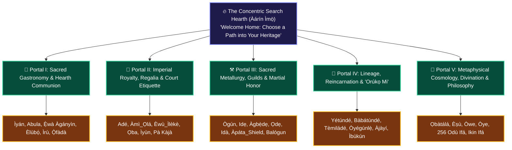

# 🏛️ THEMATIC DISCOVERY JOURNEYS: SOLVING THE BLANK SEARCH BOX
## *The Organic Narrative Portals of Àgbà Engine: Guiding the Global Seeker from Paralysis to Ancestral Revelation*

**Curator & Royal Herald**: `Ọlọ́yè Akéde` (`akede-herald`)  
**Under the Auspices of**: Lead Architect **Kábíyèsí Àrùnà Ọlànrewájú Kábírù** & **Ẹ̀gbẹ́-Àgbà**  
**Mandate**: `CHECKIN-AKEDE-004` & Plenary Decree 2  
**Classification**: CANONICAL NARRATIVE & UX DISCOVERY SPECIFICATION (SSOT)  
**Tone Protocol**: Dignified • Welcoming • Radically Accessible • Epistemologically Rich  

---

> ### 👑 *The Proverb of the Welcoming Hearth*
> *"Àlejò kì í mọ ọ̀nà ilé àyàfi bí onílé bá fọwọ́ hàn án."*  
> *(The guest cannot know the inner pathways of the ancestral compound unless the host graciously takes them by the hand and shows the way.)*  
> — Classical Yorùbá Axiom

---

## 🧭 PART 1: The Dilemma of the Blank Search Box

In conventional search engines (Google, Bing, Perplexity), the interface begins with a flashing cursor in an empty input box.

This paradigm works only if the seeker **already possesses the vocabulary of what they seek.**

For our audience, this is a catastrophic barrier:
* A third-generation Afro-Brazilian seeker in Salvador da Bahia does not know how to spell `Gbẹ̀gị̀rị́` or `Ìwunṣọ`.
* A 19-year-old student in London or Atlanta does not know that ancient Yorùbá warfare had complex bucklers (`Àpáta_Shield`) or that iron-smelting guilds (`Àgbẹ̀dẹ`) operated with specialized metallurgical liturgies.
* An everyday person who opens Àgbà Engine faces **Search Paralysis**: *“What am I supposed to type?”*

**Thematic Discovery Journeys solve this paralysis permanently.** Instead of an interrogator demanding keywords, Àgbà Engine becomes a gracious elder sitting at the hearth, presenting **curated, thematic gateways** that guide the seeker directly into our newly hardened corpus of 1,413 canonical nodes.

---

## 🌟 PART 2: The Five Curated Discovery Portals

---

### 🍲 Portal I: The Hearth of Sacred Gastronomy & Agrarian Communion
* **Narrative Hook**: *"Taste the living history: Why African cuisine is not mere food, but an unbroken covenant between soil, health, and ancestral communion."*
* **Core Anchor Nodes**: `Ìyán` (The Queen of Meals), `Abula` (Tripartite Soup Synergy), `Ẹ̀wà Àgányìn` (Caramelized Mashed Beans), `Àkàrà` (Spiced Bean Fritters), `Èlùbọ́` (Yam Flour Technology), `Ìrù` (Fermented Locust Bean Seasoning), `Ọ̀fàdà` (Ancestral Upland Rice), `Èwùrà` (Water Yam), `Ikọkọrẹ` (Ìjẹ̀bú Pottage).
* **The Story to Tell**: For centuries, Western food science dismissed indigenous African culinary practices. Àgbà Engine reveals how the alkaline fermentation of `Ìrù` provided essential umami amino acids, and how `Ìyán` served as the ultimate ceremonial anchor of peace and hospitality.

---

### 👑 Portal II: The Court of Imperial Royalty, Regalia & Court Etiquette
* **Narrative Hook**: *"Step across the palace threshold: The royal crowns, sacred coral beads, and court protocols of classical Yorùbá monarchs."*
* **Core Anchor Nodes**: `Adé` (The Sovereign Crown), `Àmì_Ọlá` (Emblems of Nobility), `Èwù_Ìlèkè` (Beaded Royal Tunic), `Ọba` (The Sacred Monarch), `Ìyùn` (Ancient Royal Coral Beads), `Fìlà Abetí-Ajá` (Dog-Eared Cap), `Pà Kàjà` (Sash of Distinction).
* **The Story to Tell**: Dispel colonial myths that reduced African kings to "tribal chiefs." Reveal the complex legislative checks of the Ògbóni council, the sacred metallurgy of lost-wax brass crowns, and why YOLOv8 misclassifying royal beads as a "necktie" sparked the creation of this engine.

---

### ⚒️ Portal III: The Anvil of Sacred Metallurgy, Guilds & Martial Honor
* **Narrative Hook**: *"Masters of the sacred flame: The ancient blacksmiths, iron smelters, hunter-scouts, and generals who engineered civilization."*
* **Core Anchor Nodes**: `Ògún` (Primordial Deity of Iron & Truth), `Idẹ` (Brass Casting), `Àgbẹ̀dẹ` (The Blacksmith Forge), `Ọdẹ` (The Guild of Hunters & Scouts), `Idà` (Consecrated Battle Blade), `Àpáta_Shield` (Defensive War Shield), `Ọfà` (Archery & Arrowcraft), `Balógun` (Supreme General of the Host).
* **The Story to Tell**: Centuries before Europe's industrial revolution, African blacksmiths managed blast-furnace temperatures exceeding 1,200°C to forge agrarian hoes (`Ọkọ́`) and tactical defensive bucklers. Explore the chivalric martial codes of the Yorùbá warrior class.

---

### 🧬 Portal IV: The River of Lineage, Reincarnation & "Orúkọ Mi"
* **Narrative Hook**: *"Find your name in the ancestral stars: The 5 grammatical classes of African onomastics and the miracle of ancestral return."*
* **Core Anchor Nodes**: `Yétúndé` (The Mother Returns), `Bàbátúndé` (The Patriarch Returns), `Tèmiládé` (Innate Royalty), `Òyégúnlẹ̀` (Discernment Has Docked), `Àjàyí` (Vanguard of Truth), `Ìbùkún` (Measured Abundance), `Ẹbí` (The Extended Family), `Ìyá` (The Primordial Matriarch), `Bàbá` (The Compound Pillar).
* **The Story to Tell**: A name is not a label; it is an entire sentence and family charter. Connect the seeker directly to the Orúkọ Mi Golden Lineage Ribbon and Auntie Yẹmí's vocal pitch contours.

---

### 🌌 Portal V: The Mind of the Cosmos: Ethics, Divination & Philosophy
* **Narrative Hook**: *"Beyond data into wisdom: The moral cosmology, binary divination matrices, and proverbs of our ancestors."*
* **Core Anchor Nodes**: `Ọbàtálá` (Arch-Sculptor of Moral Character), `Èṣù` (Divine Crossroad Mediator & Universal Translator), `Òwe` (Indigenous Proverbs & Epistemic Maxims), `Òye` (Deep Cognitive Discernment), `256 Odù Ifá`, `Ikin Ifá` (Sacred Palm Nuts), `Ọ̀pẹ̀lẹ̀` (Divination Chain).
* **The Story to Tell**: Rescue `Èṣù` from colonial missionary demonization, restoring him as the supreme cosmic translator and impartial guardian of truth. Explore binary probability in Ifá divination centuries before Leibniz.

---

## 🛠️ PART 3: Architectural Recommendations for `Àgbẹ̀dẹ` & `Àgbà`

To ensure frictionless implementation tomorrow without adding UI bloat:
1. **Declarative Journey Schema (`web/src/data/thematic_journeys.json`)**:
   - Store all journey metadata in a static JSON file (< 100 LOC). Do not hardcode narrative strings inside React components (`SearchTab.jsx`).
2. **One-Tap Multi-Node Awakening**:
   - Tapping a portal chip should instantly load its cluster of anchor nodes into `VeinRabbitHoleCanvas.jsx`, allowing immediate visual exploration with zero typing.
3. **Mobile-First Serenity**:
   - Render portals as elegant, swipeable pill badges directly beneath the concentric search hearth (`Àárín Ìmọ̀`), keeping the viewport uncluttered on mobile devices.

---

*Authored by `Ọlọ́yè Akéde` (`akede-herald`) on November 3, 2026. Sealed in the Sovereign Storytelling War Chest.*
