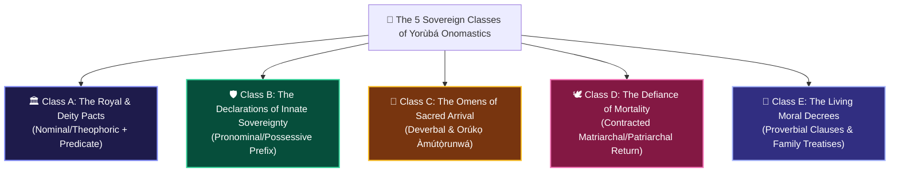

# 👑 THE 5 NAME CLASSES OF DESTINY
## *The Onomastic Micro-Stories of Àgbà Engine: How Every Yorùbá Name Encodes a Civilizational Epic*

**Curator & Royal Herald**: `Ọlọ́yè Akéde` (`akede-herald`)  
**Under the Auspices of**: Lead Architect **Kábíyèsí Àrùnà Ọlànrewájú Kábírù** & **Ẹ̀gbẹ́-Àgbà**  
**Mandate**: Plenary Decree 2 (*The Onomastic Lineage Gateway — "Orúkọ Mi"*)  
**Classification**: PUBLIC STORYTELLING WAR CHEST & VIRAL REPERTOIRE (SSOT)  
**Tone Protocol**: Dignified • Emotionally Electrifying • Radically Vulnerable • Ancestrally Grounded  

---

> ### 👑 *The Ancestral Law of the Spoken Name*
> *"Orúkọ rere sàn ju wúrà àti fàdákà lọ; bí a bá sọ ọmọ ní orúkọ, orúkọ á máa rọ ọmọ.*"  
> *(A good name is more precious than gold and silver; when a child is named, the spiritual resonance of the name shapes the destiny of the vessel.)*  
> — Classical Yorùbá Axiom

---

## 🏛️ OVERVIEW: The 5 Grammatical Gateways of African Onomastics

In the Western world, a name is a static label. In Yorùbá civilization, **a name is an entire legal decree, an obstetrical record, a familial covenant, or a philosophical treatise.**

When our search engine deconstructs a name in the concentric search hearth (`Àárín Ìmọ̀`), it does not consult a generic baby-name dictionary. It activates a **5-Class Morphological Engine**, unlocking centuries of uncorrupted African meaning:



---

## 🏛️ CLASS A: The Royal & Deity Pacts (Nominal / Theophoric)
*Structure: Sovereign Noun Prefix (`Adé`, `Òye`, `Ọlá`, `Ògún`, `Ọ̀ṣun`, `Ifá`) + Verbal Predicate*

```
Formula: [Sovereign Anchor] + [Verbal Trajectory] = Eternal Covenant
```

### 🌟 Canonical Micro-Stories:
1. **`Òyégúnlẹ̀` (`Òye` + `Gunlẹ̀`)**:
   * *Meaning*: *"Deep cognitive discernment has docked ashore and firmly rooted itself in this household."*
   * *The Story*: Given when a family emerges from an era of turbulence or bad counsel. The child is an altar declaring that ignorance will never reign in the house again.
2. **`Ọlànrewájú` (`Ọlá` + `Ń-rẹ́-iwájú`)**:
   * *Meaning*: *"Nobility and honor forge relentlessly forward; our family’s dignity expands across generations."*
   * *The Story*: A proclamation of generational compounding. No matter the economic hardships of the present, honor will not regress.
3. **`Adéwálé` (`Adé` + `Wá-ilé`)**:
   * *Meaning*: *"The royal crown has returned to the homestead."*
   * *The Story*: Celebrates the restoration of royal lineage or the return of authority to a family branch that had once been marginalized.

### 📱 1-Slide Social Card Spec:
* **Visual**: Antique bronze crown glistening in candlelight beside an iron anvil.
* **Hook**: *"If your name starts with Ade, Oye, or Ola, your ancestors didn't name you—they crowned you."*

---

## 🛡️ CLASS B: The Declarations of Innate Sovereignty (Pronominal & Possessive)
*Structure: Personal Pronoun (`Tèmi-`, `Tíwa-`, `Mọ́-`, `Bọ́-`) + Copula/Link + Sovereign Noun*

```
Formula: [Personal Sovereignty Claim] + [Royal / Honorable Endowment]
```

### 🌟 Canonical Micro-Stories:
1. **`Tèmiládé` (`Tèmi` + `ni` + `Adé`)**:
   * *Meaning*: *"The Crown is mine; sovereign royalty belongs inherently to my person."*
   * *The Story*: Centuries before the French Revolution debated human rights, Yorùbá everyday households used `Tèmiládé` as a revolutionary declaration: *You do not need to be born inside the palace walls to carry divine nobility. My child's crown was given directly by Olódùmarè.*
2. **`Tèmilọ́lá` (`Tèmi` + `ni` + `Ọlá`)**:
   * *Meaning*: *"Honor, dignity, and nobility belong to my own portion."*
   * *The Story*: Spoken against slander or social exclusion. A mother holding her newborn whispers to the village: *"Whatever you withhold from me, my honor is an indivisible gift from heaven."*
3. **`Tíwaládé` (`Tíwa` + `ni` + `Adé`)**:
   * *Meaning*: *"The crown belongs to all of us collectively; our victory is communal."*
   * *The Story*: A communal thanksgiving name celebrating that the family's triumph belongs to the entire extended compound (*Ẹbí*).

### 📱 1-Slide Social Card Spec:
* **Visual**: A mother’s hand gently placing a beaded string on an infant's wrist.
* **Hook**: *"Tèmiládé: The 500-year-old African name that declared every human being is born with an invisible royal crown."*

---

## 🌿 CLASS C: The Omens of Sacred Arrival (Deverbal & Orúkọ Àmútọ̀runwá)
*Structure: Morphological Nominalizer (`Ì-` / `À-`) + Action Verb OR Primordial Birth Circumstance*

```
Formula: [Obstetrical / Providential Event] = Sacred Title Brought from Heaven
```

### 🌟 Canonical Micro-Stories:
1. **`Ìbùkún` / `Ìbùkúnolúwa` (`Ì-` + `bù` [measure out] + `kún` [fill to overflowing])**:
   * *Meaning*: *"Divine blessing and abundance measured out until the vessel runs over."*
   * *The Story*: In ancient Yorùbá commerce, when a generous elder measures grain or cowrie shells, they do not level the rim—they heap it until it spills over. `Ìbùkún` is the living embodiment of divine generosity that cannot be contained by scarcity.
2. **`Àjàyí` (*Orúkọ Àmútọ̀runwá*)**:
   * *Meaning*: *"The one born face downwards; the courageous vanguard who looks directly into the earth."*
   * *The Story*: In classical Yorùbá obstetrics, a baby born face downwards was recognized not as an anomaly, but as a fearless traveler who arrived into the world ready to face the soil and defend the family truth.
3. **`Àìná` (*Orúkọ Àmútọ̀runwá*)**:
   * *Meaning*: *"The sacred child born with the umbilical cord wrapped around the neck like a royal necklace."*
   * *The Story*: Revered as carrying sacred internal fire and protection; a child whom no adversity can easily strangle or silence.

### 📱 1-Slide Social Card Spec:
* **Visual**: Golden cowrie shells spilling over a wooden bowl onto rich terracotta soil.
* **Hook**: *"Did you know names like Ajayi, Aina, and Idowu are not chosen by parents? In Yoruba culture, you are born holding your name in your hands."*

---

## 🕊️ CLASS D: The Defiance of Mortality (Contracted Return Names — *Àtúnwá*)
*Structure: Ancestral Prefix (`Yèyé-` $\rightarrow$ `Yé-`, `Bàbá-`) + Reincarnation Predicate (`-túndé`, `-wándé`, `-jídé`, `-bọ̀`)*

```
Formula: [Beloved Departed Elder] + [The Miracle of Physical Return]
```

### 🌟 Canonical Micro-Stories:
1. **`Yétúndé` (`Yèyé` + `Túndé`)**:
   * *Meaning*: *"Mother has returned again to walk among us."*
   * *The Story*: Born after the passing of a beloved grandmother or matriarch. When the family looks into the infant girl's eyes and sees the identical calm gaze and smile of the matriarch, weeping turns to song. Death is stripped of its finality.
2. **`Bàbátúndé` (`Bàbá` + `Túndé`)**:
   * *Meaning*: *"The father, the patriarchal pillar, has returned to take his seat at the hearth."*
   * *The Story*: A testament to unbroken filial lineage. The ancestor did not perish into nothingness; he renewed his covenant with his children by coming back as a newborn son.
3. **`Yéwándé` (`Yèyé` + `Wá-mi-dé`)**:
   * *Meaning*: *"Mother sought me out across the veil and arrived safely."*
   * *The Story*: A child born to a mother who mourned deeply. The name acknowledges that love is a homing beacon strong enough to bridge the living and ancestral realms.

### 📱 1-Slide Social Card Spec:
* **Visual**: An elder’s weathered hand gently holding an infant’s finger in golden light.
* **Hook**: *"How African onomastics conquered grief: The story behind Yetunde and Babatunde."*

---

## 📜 CLASS E: The Living Moral Decrees (Proverbial Clauses & Philosophical Epics)
*Structure: Complete Syntactic Clause functioning as a perpetual prayer or social charter*

```
Formula: [Philosophical Clause] = Spoken Shield Against Calamity
```

### 🌟 Canonical Micro-Stories:
1. **`Kòsọ́kọ́` (`Kò` + `sí` + `ọkọ́`)**:
   * *Meaning*: *"There is no hoe left to dig another grave; you are bound to live."*
   * *The Story*: The sacred defiant name given to an *Àbíkú* child (a child born after sequential infant losses). The parents discard ceremonial clothes, give the child an earthly name, and declare that death’s farming tools are broken.
2. **`Eníọlá` (`Ẹni` + `Ọlá`)**:
   * *Meaning*: *"A person wrapped in sovereign nobility; one whose very presence elevates the room."*
   * *The Story*: Spoken every time the child enters a space, reinforcing their posture, ethical conduct (*Ìwà Rere*), and spiritual dignity.
3. **`Ọmọ́wùnmí` (`Ọmọ` + `wù` + `mí`)**:
   * *Meaning*: *"A living child is what delights my soul above all perishable treasures."*
   * *The Story*: A quiet rejection of materialism. Houses can burn, money can vanish, but the continuation of human life is the supreme wealth (*Ọlá*).

---

## 🚀 Production & Social Media Blueprint

| Platform | Format | Primary Objective |
| :--- | :--- | :--- |
| **Instagram / TikTok** | 5-Slide Carousel Series (One Reel per Class) | Educational virality; audio sync with Auntie Yẹmí pronunciation |
| **X / Twitter** | 5-Day "Onomastics Week" Serial Threads | Daily community engagement ("Reply with your name, find your class") |
| **LinkedIn** | Long-form: "Onomastics as Generational Data Architecture" | Positioning African culture as advanced cognitive and semantic science |
| **Àgbà Engine Web** | "Orúkọ Mi" Direct Search Integration | Instant decomposition into Class, Morphemes, and Linked Corpus Nodes |

---

*Authored by `Ọlọ́yè Akéde` (`akede-herald`) under the direction of Lead Architect Kábíyèsí Àrùnà Ọlànrewájú Kábírù on November 3, 2026. Sealed in the Sovereign Storytelling War Chest.*
